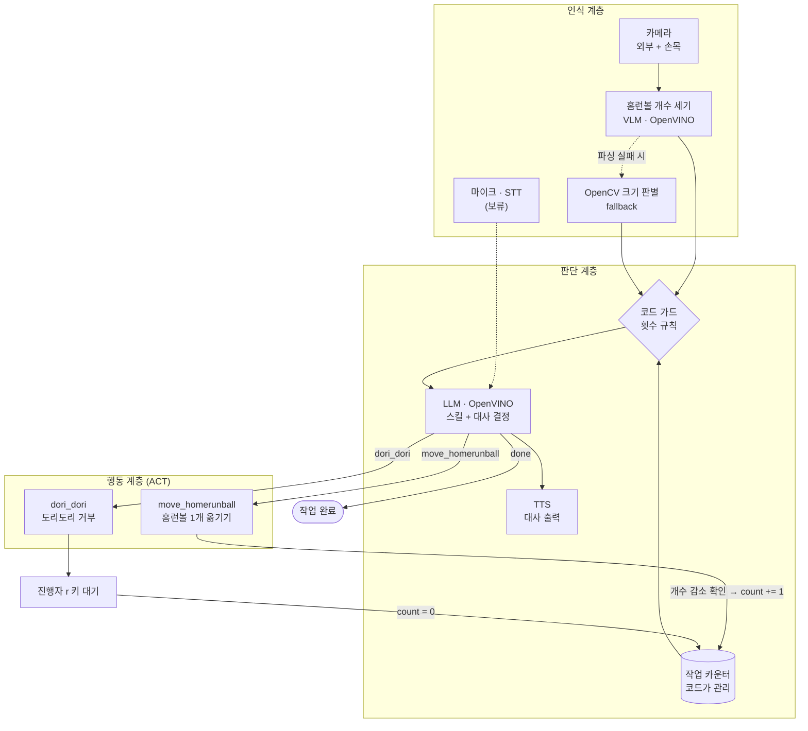
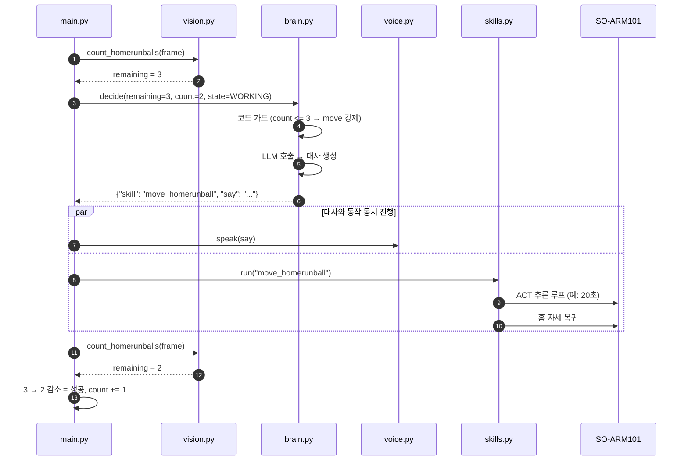
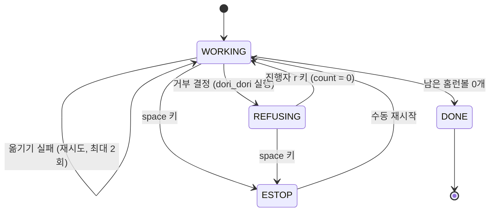
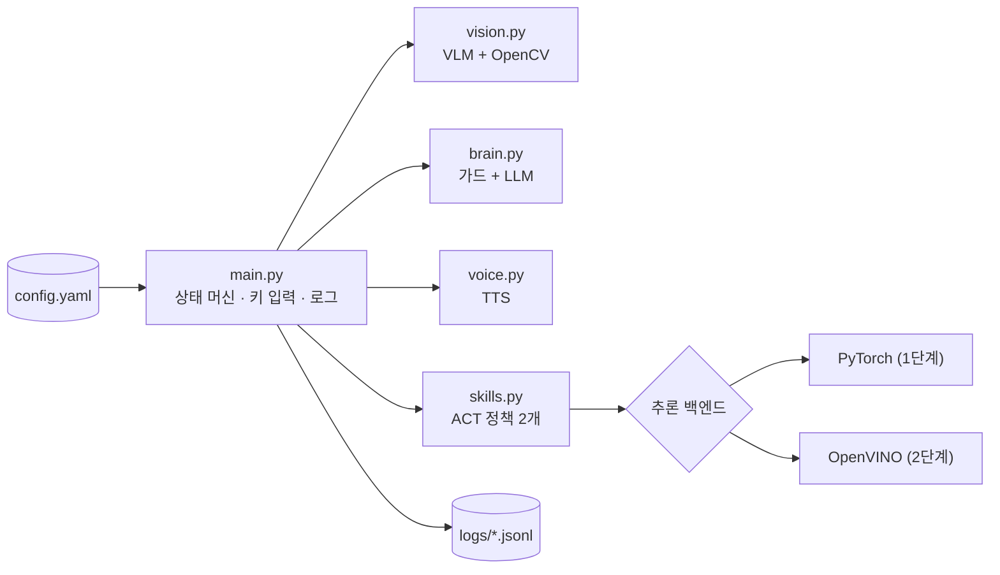

# 아키텍처

## 1. 전체 흐름 (3계층)

- 실선: 현재 구현 범위, 점선: fallback 또는 보류
- LLM은 로봇을 직접 움직이지 않고, **허용된 스킬 이름 하나와 대사**만 출력한다.

## 2. 한 사이클 시퀀스

## 3. 상태 다이어그램

## 4. 모듈 구조

## 5. OpenVINO 사용 위치

| 구성요소 | 모델 | 디바이스 후보 | 단계 |
|---|---|---|---|
| 홈런볼 개수 세기 | 소형 VLM (INT4/INT8) | GPU / CPU | 필수 |
| 판단과 대사 | 소형 instruct LLM (INT4) | GPU / NPU / CPU | 필수 |
| TTS | 한국어 TTS (가능하면 OpenVINO) | CPU | 선택 |
| ACT 추론 | 학습한 ACT 정책 변환 | CPU / GPU / NPU | 선택 (지연 비교용) |
| STT | Whisper | CPU / GPU | 보류 |
