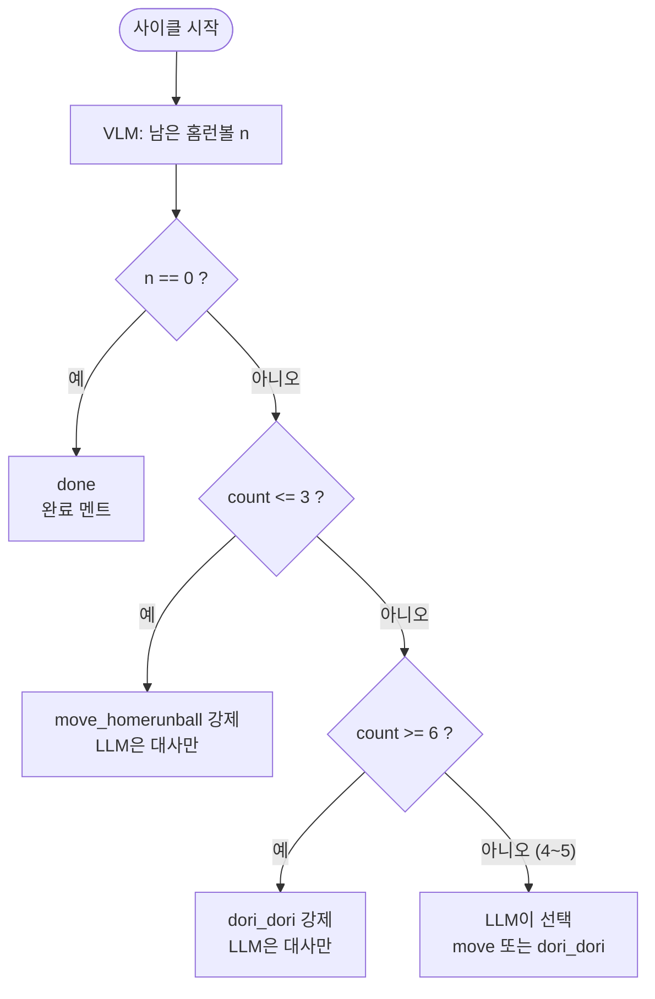

# 판단 로직

## 1. 역할 분담

| 누가 | 무엇을 |
|---|---|
| 코드 | 작업 횟수 세기, 성공 판정, 가드 규칙 적용, 허용 외 출력 차단 |
| LLM | 가드가 허용한 범위 안에서 스킬 선택, 대사 생성 |
| ACT | 선택된 동작 한 번 실행 (기억 없음) |

## 2. 가드 규칙



| 조건 | 결정 | 비고 |
|---|---|---|
| n == 0 | `done` | 최우선 |
| count ≤ 3 | `move_homerunball` 강제 | 3회째부터는 예고 멘트 허용 |
| count 4~5 | LLM 선택 | 매번 달라지는 재미 구간 |
| count ≥ 6 | `dori_dori` 강제 | |

임계값은 `config.yaml`:

```yaml
decision:
  safe_max: 3        # 이하면 무조건 일함
  force_refuse: 6    # 이상이면 무조건 거부
  max_retry: 2       # 옮기기 실패 시 재시도 횟수
```

## 3. 성공 판정

- 옮기기 전 개수 `n_before`, 옮긴 후 개수 `n_after`
- `n_after < n_before` → 성공, `count += 1`
- 아니면 실패 → 실패 멘트 후 재시도 (최대 `max_retry`회) → 그래도 실패하면 진행자 확인 대기
- 실패는 count에 넣지 않는다.

## 4. LLM 출력 스키마

```json
{
  "skill": "move_homerunball | dori_dori | done",
  "say": "한국어 대사 1~2문장"
}
```

검증 순서:
1. JSON 파싱 실패 → fallback
2. `skill`이 허용 값이 아님 → fallback
3. 가드가 강제한 skill과 다름 → **가드 결과로 덮어쓰고** 대사만 사용
4. `say`가 비었거나 너무 김(예: 80자 초과) → 준비된 대사 목록에서 랜덤

## 5. 시스템 프롬프트 초안

```text
너는 과자 공장에서 홈런볼만 골라 옮기는 로봇팔이야.
성실하지만 금방 지치는 투덜이 성격이야. 말은 짧고 귀엽게, 한국어 1~2문장으로 해.

매번 다음 정보를 받아:
- remaining: 트레이에 남은 홈런볼 개수
- count: 지금까지 옮긴 횟수
- allowed: 이번에 고를 수 있는 행동 목록
- speech_text: 사람이 한 말 (없으면 null)

규칙:
- 반드시 allowed 안에서만 skill을 골라.
- count가 3쯤이면 슬슬 힘들다는 예고를 해.
- count가 4~5면 계속할지 거부할지 네가 정해. 거부하면 dori_dori.
- remaining이 0이면 done을 고르고 뿌듯해해.

출력은 JSON 한 줄만:
{"skill": "...", "say": "..."}
```

사용자 메시지 예시:

```json
{"remaining": 2, "count": 4, "allowed": ["move_homerunball", "dori_dori"], "speech_text": null}
```

## 6. fallback 대사 (LLM 실패 시)

| skill | 대사 예시 |
|---|---|
| move_homerunball | "홈런볼 하나 옮길게요!", "이번 것도 제가 할게요." |
| move (count 3) | "으… 팔이 조금 뻐근한데요.", "이거 몇 개 남았어요?" |
| dori_dori | "싫어요! 힘들어요!", "오늘은 여기까지예요…" |
| done | "다 옮겼어요! 칭찬해 주세요.", "홈런볼 정리 완료!" |
| 실패 재시도 | "어라, 놓쳤네요. 다시 해볼게요." |
| 재개 (r 키) | "알겠어요… 조금만 더 할게요." |

## 7. STT 연결 시 (보류)

- 거부 상태에서 `speech_text`가 들어오면 LLM이 재개 여부를 판단하도록 `allowed`에 `resume`을 추가하는 방식으로 확장한다.
- 그 전까지 재개는 진행자 `r` 키로만 한다.
