# 시연 런북

## 1. 2일 일정

```mermaid
gantt
    title 홈런볼 로봇 2일 일정
    dateFormat HH:mm
    axisFormat %H:%M
    section 1일차
    세팅 · 캘리브레이션          :a1, 09:00, 2h
    도리도리 녹화 · 학습 시작      :a2, after a1, 1h
    홈런볼 녹화 (50~60 에피소드)  :a3, after a2, 3h
    홈런볼 ACT 학습 (밤사이)      :a4, after a3, 10h
    dry-run 코드 (vision·brain·voice) :a5, 12:00, 7h
    section 2일차
    스킬 단독 테스트              :b1, 09:00, 1h30m
    전체 루프 통합                :b2, after b1, 2h
    리허설 · 영상 촬영            :b3, after b2, 2h
    발표                         :b4, after b3, 1h
```

## 2. 시연 직전 체크리스트
- [ ] 카메라 위치·조명이 녹화 때와 같은지 확인
- [ ] 트레이 위치 테이프 표시에 맞추기
- [ ] 로봇 홈 자세, 토크 상태 확인
- [ ] `python main.py --dry-run` 1회 통과
- [ ] 스피커 볼륨 확인 (TTS)
- [ ] 홈런볼 3개 + 다른 과자 2개 배치
- [ ] **성공 영상 백업**이 발표 자료에 들어가 있는지 확인

## 3. 진행자 대본 예시
1. "이 로봇은 과자 공장 직원입니다. 홈런볼만 골라내요." → 시작
2. 1~3회: 로봇이 옮기면서 점점 투덜댐
3. 4~6회: 로봇이 도리도리하며 거부 → 관객 반응
4. 진행자: "조금만 더 해 주세요~" + `r` 키 → 로봇 재개
5. 마지막 홈런볼까지 옮기면 완료 멘트

## 4. 장애 대응

| 증상 | 원인 후보 | 대응 |
|---|---|---|
| 엉뚱한 과자를 집음 | 배치가 학습 분포 밖, 조명 변화 | 배치를 녹화 때와 비슷하게, 조명 조정 |
| 집기 계속 실패 | 카메라 이동, 캘리브레이션 틀어짐 | 카메라 테이프 위치 확인, 재시작 |
| VLM 개수가 틀림 | 조명, 과자 겹침 | config에서 OpenCV fallback으로 전환 |
| LLM 응답이 느림 | 디바이스 부하 | 더 작은 모델 또는 fallback 대사 모드 |
| 대사가 안 나옴 | 오디오 장치 | 콘솔 대사를 화면에 띄워 대체 |
| 로봇 이상 동작 | — | **space 비상정지** → 홈 자세 → `r` |
| 전부 안 됨 | — | 백업 영상 재생 |

## 5. 발표에서 보여줄 숫자 (logs/ 에서 집계)
- 사이클당 단계별 지연: VLM / LLM / ACT 실행 (ms)
- 옮기기 성공률 (성공 / 시도)
- (선택) ACT 추론 PyTorch vs OpenVINO 지연 비교
