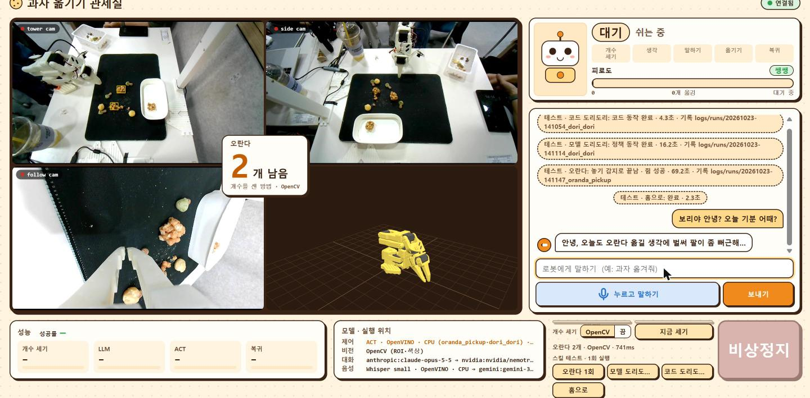
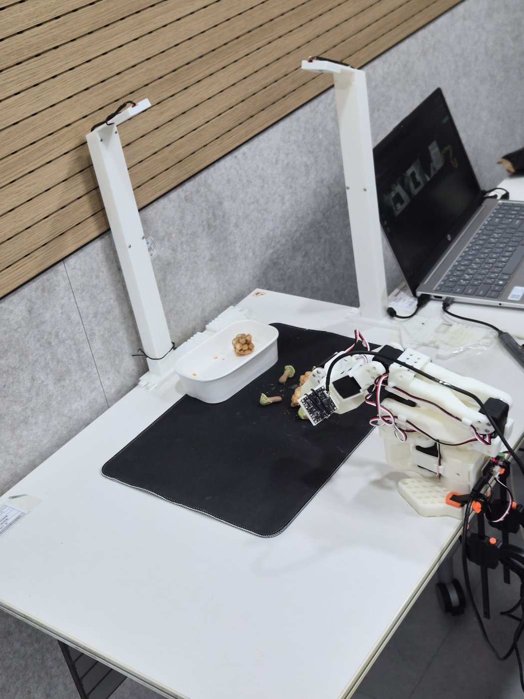
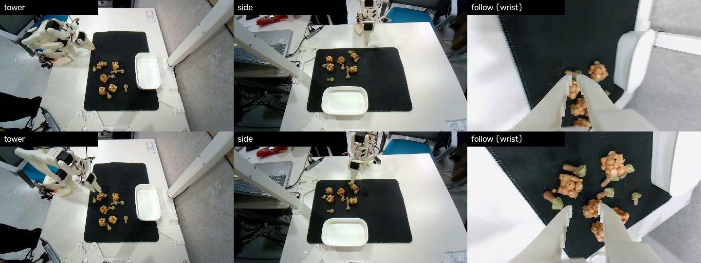
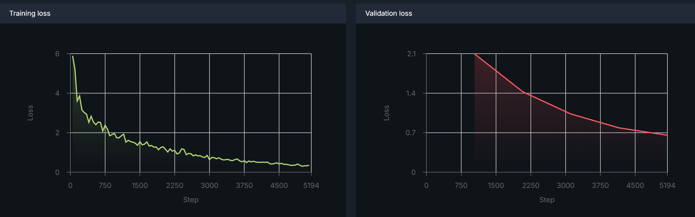
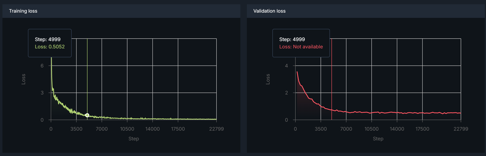

# 과자 옮기는 로봇팔, 보리

> 저장소 이름이 홈런볼인 건 원래 홈런볼을 옮기려 했기 때문입니다. 그런데 홈런볼은 사람이 집어도 힘 조절이 어려울 만큼 쉽게 찌그러져서, 몇 번 해 보다가 그나마 단단한 오란다로 바꿨습니다.

Intel OpenVINO 과정에서 로봇팔을 활용해 만든 팀 프로젝트입니다 (2026-10-22~23, 발표 10-23 금요일).

SO-ARM101 로봇팔이 여러 과자가 섞인 트레이에서 오란다만 골라 빈 트레이로 옮깁니다. 작업은 채팅이나 음성으로 시킵니다.
보리는 성실하지만 금방 지치는 캐릭터입니다. 절반쯤 옮기면 고개를 저으며(도리도리) 그만하겠다고 하고, "조금만 더 해 줘"라고 달래면 다시 일합니다.



## 어떻게 돌아가나

```
채팅 / 🎤 음성(Whisper)
        │
        ▼
 카메라로 오란다 개수 세기 (OpenCV)
        │
        ▼
 다음 행동 정하기: 횟수 규칙은 코드, 대사는 LLM
        │
        ├─ 옮기기   → ACT 정책 oranda_pickup (OpenVINO)
        ├─ 거부     → 도리도리
        └─ 다 옮김  → 완료
        │
        ▼
 다시 세어서 성공했는지 확인 → 반복
```

- 집고 놓는 동작은 ACT 정책이 카메라 영상만 보고 합니다. 놓은 뒤 홈 자세로 돌아오는 건 코드가 맡습니다.
- 몇 개를 옮겼고 언제 거부할지는 코드가 셉니다. LLM은 말투와 대사만 정하고, 정해진 값 밖의 행동은 고를 수 없습니다.
- 같은 과자를 두 번 연속 놓치면 투덜대고 기다립니다. "이어서 해줘"라고 하면 다시 시도합니다.
- 비상정지(space 또는 화면 버튼)를 누르면 토크를 유지한 채 그 자리에 멈춥니다.

## 사용한 것

| 부분 | 사용한 것 |
|---|---|
| 로봇 | SO-ARM101 (팔로워 1대, 데이터 녹화용 리더 1대), 카메라 3대 (위 · 옆 · 손목) |
| 동작 모델 | ACT 2개 (`oranda_pickup`, `dori_dori`), physical-ai-studio로 학습해 OpenVINO로 내보냄, `physicalai` 런타임으로 CPU 실행 |
| 개수 세기 | OpenCV (색 · 면적 규칙, 프레임 5장 중앙값) |
| 대화 | Claude → NVIDIA API → 규칙 대사 순으로 시도 |
| 음성 | STT: OpenVINO Whisper small (노트북 안), TTS: Gemini (안 되면 Windows 음성) |
| 화면 | FastAPI + 웹 UI (카메라 3개, 3D 팔, 채팅, 스킬 테스트 버튼) |

## 데이터셋과 학습

팀원 셋이 리더 팔로 팔로워 팔을 직접 움직여 시범 동작을 녹화했습니다. 카메라 3대(위 · 옆 · 손목) 영상과 관절값이 같이 저장되고, ACT는 이걸 보고 따라 하도록 학습됩니다.





| 모델 | 데이터 | 학습 | 손실 (train / val) |
|---|---|---|---|
| `oranda_pickup` | 31 에피소드, 9,111 프레임 | 5 epoch, batch 8 | 0.35 / 0.66 (아직 내려가는 중) |
| `dori_dori` | 도리도리 시범 녹화 | 100 epoch, batch 4 | 0.07 / 0.49 (데이터가 적어 과적합) |

학습은 physical-ai-studio에서 했고(ACT, resnet18, chunk 100), 결과를 OpenVINO로 내보내 노트북 CPU에서 돌렸습니다.

| oranda_pickup 손실 | dori_dori 손실 |
|---|---|
|  |  |

## 역할

| 담당 | 한 일 |
|---|---|
| 팀원 A · B · C (공동) | 데이터셋 녹화와 정리 (오란다 옮기기, 도리도리) |
| physical-ai-studio | ACT 모델 학습과 OpenVINO 내보내기 |
| ttogle918 | 전체 워크플로우 설계, 로봇 제어 · 판단 · 음성 · 웹 UI 소프트웨어, 현장 연결과 튜닝, 저장소 관리 |

## 실행

Windows 기준입니다. Ubuntu는 `.venv/Scripts/python` 대신 `.venv/bin/python`을 씁니다.

```bash
python -m venv .venv
.venv/Scripts/python -m pip install -r requirements.txt
cp .env.example .env          # 쓰는 API 키만 채운다 (없으면 규칙 대사로 돈다)

.venv/Scripts/python -m snackbot --dry-run    # 로봇 없이 전체 흐름 확인 (http://localhost:8000)
```

실제 로봇:

```bash
.venv/Scripts/python -m pip install -r requirements.txt -r requirements-robot.txt
.venv/Scripts/python -m snackbot
```

- 실제 로봇으로 돌리려면 학습한 ACT 모델을 먼저 넣어야 합니다 (아래 "모델 넣기").
- 음성 인식 모델: `hf download OpenVINO/whisper-small-int8-ov --local-dir models/whisper-small`
- 포트, 카메라 번호, 캘리브레이션, 그리퍼 값 맞추는 순서는 [시연 런북](docs/DEMO_RUNBOOK.md)에 있습니다.
- 테스트: `.venv/Scripts/python -m pytest`

## 모델 넣기

학습한 ACT 모델은 용량 때문에 저장소에 없습니다. physical-ai-studio에서 OpenVINO로 내보낸 폴더를 `trained_model/` 아래 스킬 이름으로 넣습니다.

```
trained_model/
├── oranda_pickup/exports/openvino/   # act.xml, act.bin, manifest.json
└── dori_dori/exports/openvino/
```

- 경로는 `config.yaml`의 `skills.<스킬 이름>.export_dir`에 있습니다. 다른 곳에 두면 이 값을 바꿉니다.
- 학습 때 카메라 이름이 `config.yaml`의 `cameras`와 다르면 `camera_map`으로 맞춥니다. 오란다 모델은 학습 이름이 `a`, `b`, `follow`라서 `{a: tower cam, b: side cam, follow: follow cam}`으로 연결해 두었습니다.
- 넣은 뒤 `.venv/Scripts/python -m snackbot.robot oranda_pickup`으로 한 번 돌려 봅니다 (도리도리 모델은 `dori_policy`).
- 모델이 없는 동작은 건너뛰고, 도리도리는 모델 없이 코드 동작으로도 됩니다.

자세한 순서는 [trained_model/README.md](trained_model/README.md)에 있습니다.

## 저장소 구조

```
.
├── README.md
├── config.yaml            # 카메라 · 포트 · 모델 경로 · 개수 세기 · 거부 규칙 · 음성 설정
├── poses.yaml             # 홈 · 들어 올리기 자세 (tools.robot_probe save로 저장)
├── calibration/           # 팔로워 캘리브레이션 (tools.fetch_calibration으로 Studio에서 받음)
├── .env.example           # API 키 이름 (.env로 복사해서 채움, git 제외)
├── requirements.txt       # 공통 (dry-run 포함)
├── requirements-robot.txt # 실제 로봇용 (physicalai)
├── snackbot/              # 본체
│   ├── __main__.py        #   실행 진입점 (--dry-run, --no-ui, --port)
│   ├── controller.py      #   상태 머신 (대기 · 작업 · 거부 · 완료 · 비상정지 · 테스트), 횟수 세기
│   ├── brain.py           #   다음 행동 고르기, 채팅 의도, 대사 (코드 규칙 + LLM)
│   ├── providers.py       #   LLM · STT 접속 (Claude, NVIDIA, Gemini, 로컬 OpenVINO)
│   ├── vision.py          #   오란다 개수 세기 (OpenCV)
│   ├── robot.py           #   실제 로봇: ACT 정책 실행, 홈 복귀, 비상정지
│   ├── motion.py          #   그리퍼 감시, 천천히 이동
│   ├── skills.py          #   dry-run용 가짜 동작
│   ├── stt.py · voice.py  #   음성 인식 (Whisper) · 음성 합성 (Gemini, Windows 예비)
│   ├── server.py          #   웹 서버 (채팅, 카메라 영상, 음성)
│   ├── recorder.py        #   실행 기록 저장
│   ├── twin.py            #   3D 팔 표시용 관절값 변환
│   └── wincam.py          #   Windows 카메라 목록 보정
├── frontend/              # 웹 화면 (카메라 4분할, 3D 팔, 채팅, 버튼)
├── tools/                 # 캘리브레이션 받기, 관절값 보기 · 자세 저장, 카메라 찾기, 녹화 받기
├── tests/                 # 자동 테스트 (pytest)
├── trained_model/         # ACT 모델 넣는 곳 (위 "모델 넣기")
├── models/                # Whisper 모델 · OpenVINO 캐시
├── data/                  # 학습 데이터셋 복사본
├── replays/               # dry-run 녹화 재생 데이터
├── logs/                  # 실행 로그 · 실행 기록 (자동 생성)
├── cameras/               # 카메라 확인 사진 (tools.cameras)
└── docs/                  # 발표 자료, 진행 보고서, 구조 · 판단 규칙 · 런북, 개발 기록
```

### 저장소에 없는 것

용량이 크거나 실행하면 생기는 것은 git에 올리지 않았습니다. 폴더마다 README.md에 안의 구조와 채우는 방법을 적어 두었습니다.

| 폴더 · 파일 | 무엇 | 어떻게 채우나 | 없으면 |
|---|---|---|---|
| `.env` | API 키 (Claude, NVIDIA, Gemini) | `.env.example`을 복사해 채움 | LLM 대신 준비된 대사, TTS는 Windows 음성 |
| [`trained_model/`](trained_model/README.md) | ACT 모델 2개 | physical-ai-studio에서 OpenVINO로 내보내 넣음 | 그 동작은 건너뜀 (도리도리는 코드 동작) |
| [`models/`](models/README.md) | Whisper small, OpenVINO 캐시 | `hf download` (캐시는 자동) | 음성 인식은 Gemini 예비로 |
| [`data/`](data/README.md) | 학습 데이터셋 (31 에피소드, 311MB) | physical-ai-studio의 `oranda` 프로젝트에서 받음 | 실행과 무관 (학습 데이터 확인용) |
| [`replays/`](replays/README.md) | dry-run 재생용 녹화 | `tools.fetch_replays` (Studio 네트워크에서만) 또는 실행 기록 복사 | dry-run에서 팔 · 카메라 재생 없이 진행 |
| [`logs/`](logs/README.md) | 사이클 로그, 실행 기록 | 실행하면 자동으로 생김 | — |
| [`cameras/`](cameras/README.md) | 카메라 확인 사진 | `tools.cameras` | — |

## 문서

- [발표 자료](docs/slides.html) (PowerPoint: [slides.pptx](docs/slides.pptx))
- [진행 보고서](docs/PROGRESS_REPORT.html): 한 일, 실기 결과, 남은 문제
- [구조](docs/ARCHITECTURE.md), [판단 규칙](docs/DECISION_LOGIC.md), [데이터셋 녹화 규칙](docs/DATASET_GUIDE.md)

## 시연 결과

- 오란다 집기는 12번 시도해서 1번 성공했습니다.
- 팔은 오란다 쪽으로 가서 집는 동작과 옮기는 동작을 하지만, 대부분 그리퍼가 과자를 제대로 잡지 못했습니다. 오란다 주변을 집는 정도였습니다.
- 집기 외의 부분(카메라 개수 세기, 채팅 · 음성 명령, 도리도리, 음성 대답)은 시연 전 실기 확인에서 동작했습니다.

## 한계와 다음에 해 볼 것

- **학습 부족:** 오란다 모델은 5 epoch만 돌렸고 검증 손실이 아직 내려가던 중이었습니다. 집기 실패의 가장 큰 원인으로 봅니다. epoch를 늘리고 에피소드를 더 모으면 나아질 것 같습니다.
- **제어 주기:** 실행 중 제어 루프가 11~13 Hz로 돌았습니다 (학습 데이터는 30 Hz). 동작이 녹화 때와 박자가 달라 정확도가 떨어졌을 수 있습니다. 화면 스트리밍(JPEG 인코딩) 부하가 유력한 원인인데 끝까지 고치지 못했습니다.
- **도리도리 모델:** 데이터가 적어 고개를 거의 젓지 못했고, 시연에서는 코드로 만든 도리도리를 썼습니다.
- **VLM 개수 세기:** 계획했지만 학습하지 못해 OpenCV 규칙으로 마무리했습니다.
