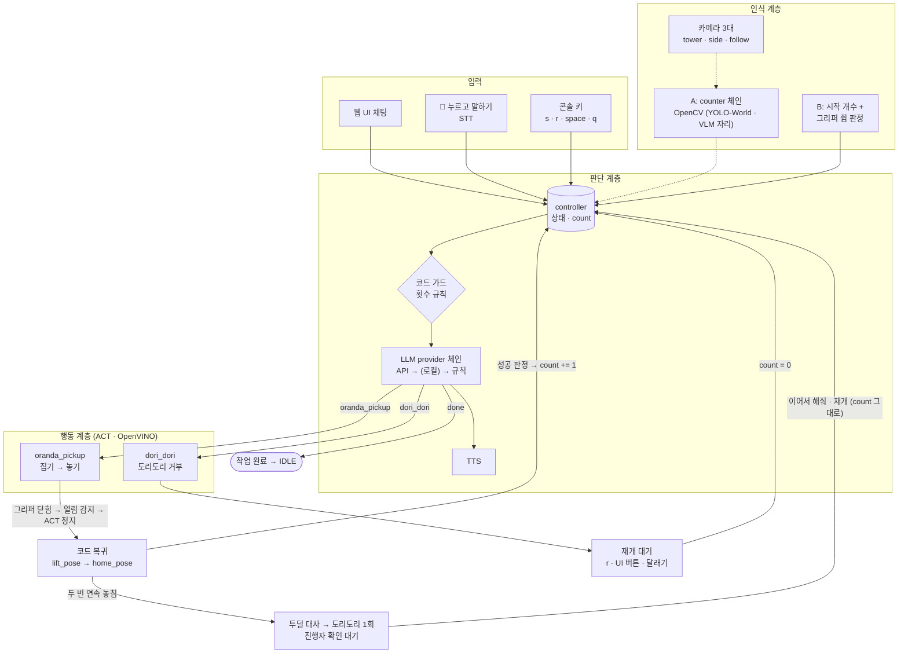
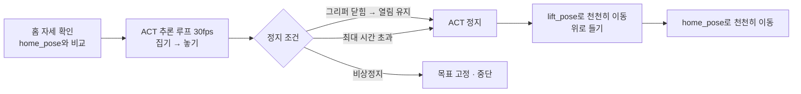
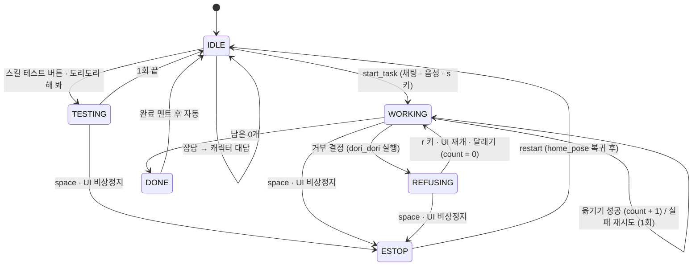
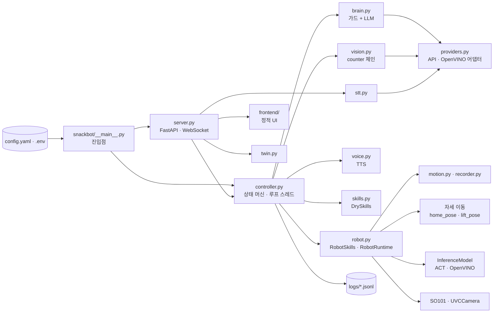

# 아키텍처

> 세부 기준은 `docs/superpowers/specs/2026-10-22-chat-ui-design.md`. 충돌하면 설계 문서가 우선한다.

## 1. 전체 흐름 (3계층)

- 점선: A단계(개수 세기, 지금은 OpenCV). UI 토글로 끄면 B단계만으로도 전체 흐름이 돈다.
- 개수는 한 번에 5프레임을 읽어 중앙값을 쓴다. 놓았는데 줄지 않았으면 0.7초 뒤 한 번 더 센다 (상세는 `DECISION_LOGIC.md` 3장).
- 과자를 찾아 집는 일은 ACT가 영상만 보고 한다. 인식 계층은 **언제 끝낼지**와 **성공했는지**만 판정한다.
- LLM은 로봇을 직접 움직이지 않고, **허용된 값 하나와 대사**만 출력한다.
- `oranda_pickup` ACT는 **놓기까지만** 한다. 홈 복귀는 학습하지 않고 코드가 저장된 자세로 강제한다.

## 1-1. oranda_pickup 실행 단계

| 단계 | 담당 | 비고 |
|---|---|---|
| 홈 자세 확인 | 코드 | 관절별 오차가 기준(5)보다 크면 먼저 home_pose로 이동 |
| 집기 → 놓기 | ACT | 학습한 구간. `RobotRuntime` + `PolicySource(InferenceModel)` (정지 신호·비상정지 세대는 `robot.py`) |
| 정지 판단 | 코드 | 닫힘 기준(56.0)을 한 번 지난 뒤 열림 기준(56.5)을 `open_hold_s`(0.15초) 넘으면, 또는 최대 시간(20초) |
| 쥠 판정 | 코드 | 닫힘 구간의 그리퍼 최솟값 ≥ `grasp_min` → 과자를 쥐었음 |
| 위로 들기 → 홈 | 코드 | 관절 공간 보간, 느린 속도. 트레이·과자 충돌 방지 |

## 2. 한 사이클 시퀀스

```mermaid
sequenceDiagram
    autonumber
    actor U as 사용자 (UI)
    participant C as controller.py
    participant B as brain.py
    participant T as voice.py
    participant S as skills.py
    participant R as SO-ARM101

    U->>C: chat("오란다 3개 옮겨줘")
    C->>B: chat(text, state=IDLE)
    B-->>C: {"intent": "start_task", "n": 3, "say": "..."}
    C->>C: IDLE → WORKING, remaining = 3
    C->>B: decide(remaining=3, count=2, state=WORKING)
    B->>B: 코드 가드 (옮긴 수 < ceil(전체/2) → oranda_pickup 강제)
    B->>B: LLM 호출 → 대사 생성
    B-->>C: {"skill": "oranda_pickup", "say": "..."}
    par 대사와 동작 동시 진행
        C->>T: speak(say)
    and
        C->>S: run("oranda_pickup")
        S->>R: ACT 추론 루프 (집기 → 놓기)
        S->>S: 그리퍼 닫힘 → 열림 감지 → ACT 정지
        S->>R: lift_pose → home_pose 이동 (코드)
        S-->>C: {stop_reason: "gripper_open", grasped: true}
    end
    C->>C: B: grasped → 성공, count += 1, remaining = 2
    Note over C: A단계: 실행 전후 counter 개수 비교로 성공 판정
    C-->>U: state · message · cycle 이벤트 (WebSocket)
```

## 3. 상태 다이어그램

- 거부(REFUSING)는 `decision.refuse: half`에서 전체의 절반(올림)을 옮긴 뒤 작업당 한 번이다 (`fixed`는 옛 고정 임계값 3·6). 상세는 `DECISION_LOGIC.md`.
- 재시도를 넘겨도 실패하면(두 번 연속 놓침) 투덜대는 대사 → 도리도리 1회 뒤 WORKING 상태에서 `phase = waiting_operator`로 재개 명령을 기다린다. 채팅·🎤 "이어서 해줘", 재개 버튼, `r` 키로 다시 시도하고 count는 그대로다. 이 도리도리는 거부(REFUSING)가 아니다.

## 4. 모듈 구조

## 5. 모델 실행 위치

| 구성요소 | 모델 | 실행 위치 | 단계 |
|---|---|---|---|
| ACT 2개 | physical-ai-studio 학습 → OpenVINO 결과물 | **로컬** CPU / GPU / NPU (시연 노트북은 CPU: GPU 컴파일이 정책마다 55~65초) | 필수 |
| 판단·대사·채팅 의도 | instruct LLM | **API** (OpenRouter / NVIDIA / 유료) → 선택적으로 로컬 OpenVINO → 규칙 | 필수 |
| 개수 세기 (A) | OpenCV(현재) / YOLO-World(OpenVINO) / VLM | 로컬 | M3 |
| STT | Whisper | 로컬 OpenVINO 또는 API | M6 |
| TTS | Gemini `gemini-2.5-flash-preview-tts` → 실패하면 Windows Microsoft Heami (SAPI) | API → 로컬 예비 | 선택 |
