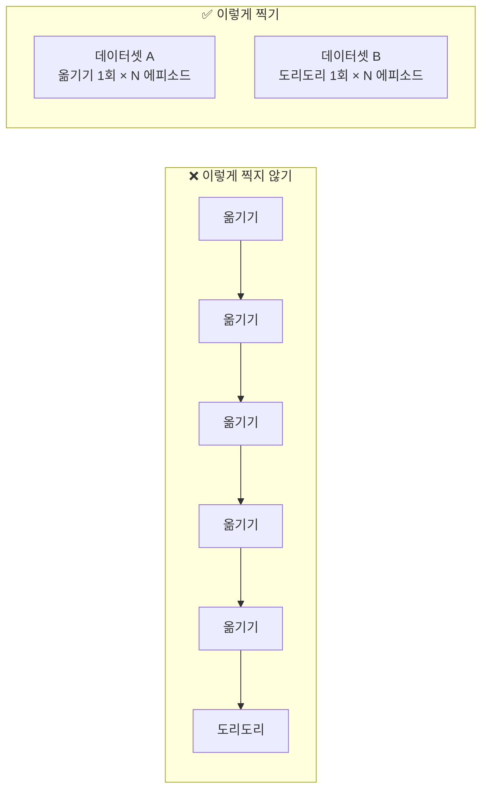
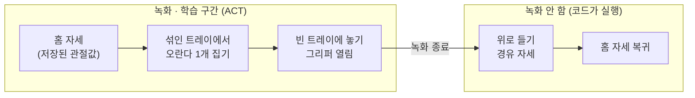
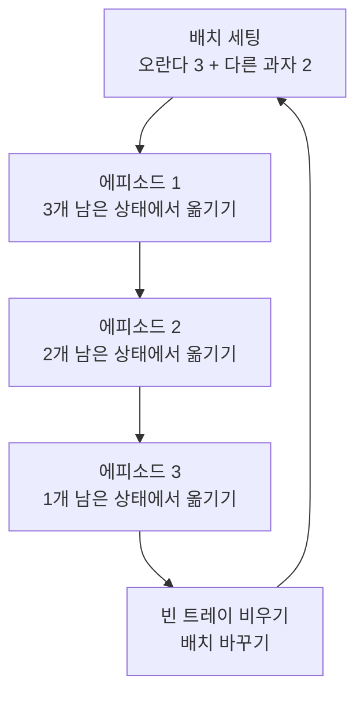
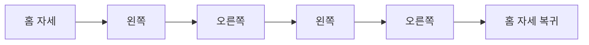

# ACT 데이터셋 가이드

## 1. 원칙

1. **데이터셋은 동작별로 따로.** `oranda_pickup`과 `dori_dori`를 섞지 않는다.
2. **에피소드 하나 = 동작 한 번.** "5번 옮기고 도리도리"를 한 에피소드로 찍지 않는다.
   ACT는 현재 화면과 관절 상태만 보고 다음 1~2초를 정하기 때문에 몇 번째인지 기억하지 못한다.
   그렇게 찍으면 아무 때나 도리도리를 하는 정책이 된다.
3. **순서와 횟수는 메인 루프가 관리한다.**
4. **홈 복귀는 학습하지 않는다 (oranda_pickup).** 데이터가 적을 때 복귀 구간은 매번 궤적이 달라
   노이즈가 된다. 에피소드는 "놓기"에서 끝내고, 복귀는 코드가 저장된 자세로 강제한다.
   덕분에 끝 장면(빈 트레이 위, 그리퍼 열림)과 시작 장면(홈 자세)이 확실히 달라져,
   "돌아오자마자 또 집으러 가는" 혼란도 사라진다.



## 2. 데이터셋 A: oranda_pickup

### 에피소드 구성



- **시작**: 매 에피소드 정확히 같은 홈 자세에서 출발 (아래 "홈 자세 맞추기" 참고)
- **끝**: 그리퍼를 열어 오란다를 놓자마자 녹화 종료. 홈 자세로 돌아오는 동작은 넣지 않는다.
- **리셋 시간**: 리더 팔을 홈 자세로 되돌린다. 이 구간은 데이터에 들어가지 않는다.
- 녹화 중 에피소드를 일찍 끝내는 키보드 단축키가 있다. 버전마다 다를 수 있으니 `lerobot-record` 실행 시 안내를 확인한다.

### 홈 자세 맞추기
- 팔로워를 홈 자세에 두고 관절값 6개를 읽어 `config.yaml`의 `home_pose`로 저장한다. 실행 코드가 이 값으로 복귀한다.
- 같은 방법으로 "놓은 뒤 위로 든 자세" 하나를 `lift_pose`로 저장한다 (트레이·과자에 걸리지 않는 높이).
- 녹화 때 리더 팔 홈 자세에 테이프 표시를 해 두고, 매 에피소드 그 자세에서 출발한다.
- 코드의 `home_pose`와 녹화 시작 자세가 다르면 ACT가 처음부터 흔들린다. 녹화 전에 실제 팔로워 관절값이 `home_pose`와 몇 도 이내인지 확인한다.

### 배치 규칙
- 매 에피소드에 **다른 과자도 같이** 놓는다 (오란다만 있으면 "아무 과자나 집기"로 배운다).
- 오란다 위치를 매번 바꾼다 (앞/뒤/좌/우).
- **헷갈리는 배치를 일부러 넣는다**: 다른 과자가 그리퍼에 더 가까운 배치, 오란다가 뒤쪽에 있는 배치.
- 트레이 위치(섞인 트레이, 빈 트레이)는 **절대 바꾸지 않는다.**
- 오란다가 없는 배치는 녹화하지 않는다 (남은 개수가 0이면 스킬 자체를 호출하지 않음).

### 연속 녹화 요령



한 세트에 에피소드 3개 → 세트 17~20회 반복 = **50~60 에피소드**.
실제 시연처럼 오란다가 점점 줄어드는 상황이 자연스럽게 다 들어간다.

### 목표 수치
| 항목 | 값 |
|---|---|
| 에피소드 수 | 50개 이상 |
| 에피소드 길이 | 10~15초 (복귀 제외) |
| 끝 지점 | 그리퍼 열고 놓은 직후 |
| 카메라 | 외부 + 손목 (둘 다 필수) |
| task 문장 | `"PIck up the Snack and place it in the empty tray"` |

## 3. 데이터셋 B: dori_dori



| 항목 | 값 |
|---|---|
| 에피소드 수 | 10~20개 (접촉이 없어 적어도 됨) |
| 에피소드 길이 | 5~6초 |
| 리더 그리퍼 | 움직이지 않기 |
| 홈 복귀 | **포함** (접촉 없는 짧은 동작이라 노이즈가 적음) |
| task 문장 | `"Shake the arm side to side to say no"` |

## 4. task 문장과 이름 규칙
- ACT는 task 문장을 입력으로 쓰지 않는다 (메모 역할). 나중에 언어 조건 모델로 바꿀 수 있으니 **영어로, 의미 있게** 쓴다.
- 한 데이터셋 안의 모든 에피소드는 **같은 문장**을 쓴다.
- 데이터셋 이름은 영문, 숫자, `_`, `-`만 쓴다.

## 5. 명령어 템플릿

> 현재 녹화·학습·OpenVINO 내보내기는 **physical-ai-studio UI**로 한다 (`openvino-physical-ai-lab/docs/05~06` 참고). 아래 LeRobot CLI는 참고용이다.

> LeRobot 버전마다 옵션 이름이 다를 수 있으니 먼저 `lerobot-record --help`, `lerobot-train --help`로 확인한다.

```bash
# 녹화 (oranda_pickup)
lerobot-record \
  --robot.type=so101_follower --robot.port=[PORT] --robot.id=[FOLLOWER_ID] \
  --robot.cameras="{ front: {type: opencv, index_or_path: [IDX], width: 640, height: 480, fps: 30}, wrist: {type: opencv, index_or_path: [IDX], width: 640, height: 480, fps: 30} }" \
  --teleop.type=so101_leader --teleop.port=[LEADER_PORT] --teleop.id=[LEADER_ID] \
  --dataset.repo_id=[HF_USER]/oranda_pickup \
  --dataset.single_task="PIck up the Snack and place it in the empty tray" \
  --dataset.num_episodes=60 \
  --dataset.episode_time_s=15 \
  --dataset.reset_time_s=10

# 학습
lerobot-train \
  --policy.type=act \
  --dataset.repo_id=[HF_USER]/oranda_pickup \
  --output_dir=outputs/train/act_oranda_pickup \
  --policy.device=[cuda|xpu|cpu] \
  --policy.push_to_hub=false
```

## 6. 녹화 전 체크리스트
- [ ] 카메라 2대 고정 (녹화 후 절대 움직이지 않기), 테이프로 위치 표시
- [ ] 트레이 2개 위치 테이프로 표시
- [ ] 조명 고정 (창문 햇빛 피하기, 발표장 조명과 비슷하게)
- [ ] 홈 자세 정하고 `home_pose`, `lift_pose` 관절값 저장
- [ ] 리더 팔 홈 자세에 테이프 표시, 매 에피소드 같은 자세에서 시작
- [ ] oranda_pickup은 놓자마자 녹화 종료 (복귀 동작 녹화 금지)
- [ ] 카메라 이름(`front`, `wrist`)을 기록 → 실행 코드와 일치시키기
- [ ] 리더 팔로 연습 5회 이상 후 녹화 시작
- [ ] 실패한 에피소드는 바로 재녹화하거나 삭제
