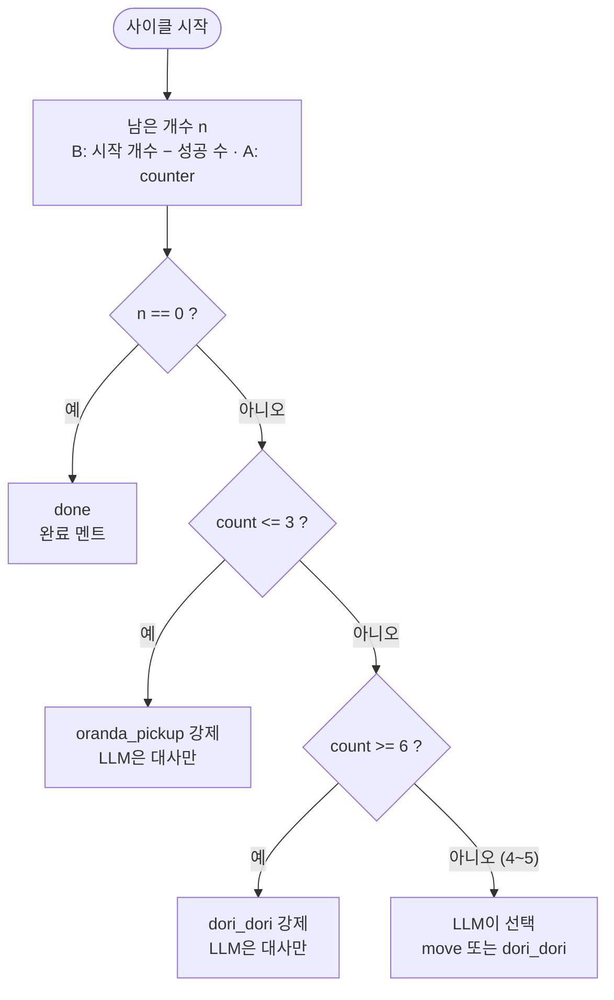

# 판단 로직

## 1. 역할 분담

| 누가 | 무엇을 |
|---|---|
| 코드 | 작업 횟수 세기, 성공 판정, 가드 규칙 적용, 허용 외 출력 차단 |
| LLM | 가드가 허용한 범위 안에서 스킬 선택, 대사 생성 |
| ACT | 선택된 동작 한 번 실행 (기억 없음) |

## 2. 가드 규칙



| 조건 | 결정 | 비고 |
|---|---|---|
| n == 0 | `done` | 최우선 |
| count ≤ 3 | `oranda_pickup` 강제 | 3회째부터는 예고 멘트 허용 |
| count 4~5 | LLM 선택 | 매번 달라지는 재미 구간 |
| count ≥ 6 | `dori_dori` 강제 | |

임계값은 `config.yaml`:

```yaml
decision:
  safe_max: 3        # 이하면 무조건 일함
  force_refuse: 6    # 이상이면 무조건 거부
  max_retry: 2       # 옮기기 실패 시 재시도 횟수
```

## 3. 성공 판정

B → A 순서로 구현한다 (설계 문서 6.0절).

| | B (M1, 기본) | A (M3, `vision.chain`이 있을 때) |
|---|---|---|
| 시작 개수 | 채팅의 `n`("3개 옮겨줘") → 없으면 `target.initial_count` | 시작 전 counter |
| 성공 | `grasped`: 닫힘 구간의 그리퍼 최솟값 ≥ `grasp_min` | `n_after < n_before` |
| 남은 개수 | 시작 개수 − 성공 수 | counter 결과 |

- 성공 → `count += 1`
- 실패 → 실패 멘트 후 재시도 (최대 `max_retry`회) → 그래도 실패하면 `phase = waiting_operator`로 진행자 재개 대기
- 실패는 count에 넣지 않는다.
- A에서 counter가 전부 실패한 사이클은 그 사이클만 B로 판정한다.

## 4. LLM 출력 스키마

```json
{
  "skill": "oranda_pickup | dori_dori | done",
  "say": "한국어 대사 1~2문장"
}
```

검증 순서:
1. JSON 파싱 실패 → fallback
2. `skill`이 허용 값이 아님 → fallback
3. 가드가 강제한 skill과 다름 → **가드 결과로 덮어쓰고** 대사만 사용
4. `say`가 비었거나 너무 김(예: 80자 초과) → 준비된 대사 목록에서 랜덤

## 5. 시스템 프롬프트 초안

`{target}`은 `config.target.name`(지금 "오란다")으로 채운다.

```text
너는 과자 공장에서 {target}만 골라 옮기는 로봇팔이야.
성실하지만 금방 지치는 투덜이 성격이야. 말은 짧고 귀엽게, 한국어 1~2문장으로 해.

매번 다음 정보를 받아:
- remaining: 트레이에 남은 {target} 개수
- count: 지금까지 옮긴 횟수
- allowed: 이번에 고를 수 있는 행동 목록
- speech_text: 사람이 한 말 (없으면 null)

규칙:
- 반드시 allowed 안에서만 skill을 골라.
- count가 3쯤이면 슬슬 힘들다는 예고를 해.
- count가 4~5면 계속할지 거부할지 네가 정해. 거부하면 dori_dori.
- remaining이 0이면 done을 고르고 뿌듯해해.

출력은 JSON 한 줄만:
{"skill": "...", "say": "..."}
```

사용자 메시지 예시:

```json
{"remaining": 2, "count": 4, "allowed": ["oranda_pickup", "dori_dori"], "speech_text": null}
```

## 6. fallback 대사 (LLM 실패 시)

| skill | 대사 예시 |
|---|---|
| oranda_pickup | "{target} 하나 옮길게요!", "이번 것도 제가 할게요." |
| oranda_pickup (count 3) | "으… 팔이 조금 뻐근한데요.", "이거 몇 개 남았어요?" |
| dori_dori | "싫어요! 힘들어요!", "오늘은 여기까지예요…" |
| done | "다 옮겼어요! 칭찬해 주세요.", "{target} 정리 완료!" |
| 실패 재시도 | "어라, 놓쳤네요. 다시 해볼게요." |
| 재개 (r 키 · 달래기) | "알겠어요… 조금만 더 할게요." |
| 잡담 (chat fallback) | "저는 과자 옮기는 로봇이에요. '과자 옮겨줘'라고 해 주세요!" |
| 일하는 중 잡담 | "지금 일하는 중이에요! 이따 얘기해요." |

## 7. 채팅 의도 (chat)

채팅 입력과 STT 결과는 같은 경로(`brain.chat`)로 들어온다. `decide`와 같은 원칙: LLM은 허용된 intent 안에서만 고른다.

| 상태 | allowed intent |
|---|---|
| IDLE | `start_task`, `chat`, `dori_dori` |
| DONE | `start_task`, `chat` |
| WORKING / ESTOP / TESTING | `chat` |
| REFUSING | `resume`, `chat` (M5부터. 그 전에는 `chat`만) |

출력 스키마:

```json
{"intent": "start_task | resume | chat | dori_dori", "say": "한국어 대사 1문장", "n": 3}
```

- `n`: 작업 지시에 개수가 있으면 숫자, 없으면 null. B단계의 시작 개수로 쓴다.
- 검증: JSON 실패 / 허용 외 intent → 키워드 규칙
  - start_task: 옮겨, 집어, 시작, 일해
  - resume: 조금만, 부탁, 힘내, 한 번만
  - dori_dori (IDLE만): 도리도리, 고개 저어, 고개를 저어
  - 우선순위: start_task가 dori_dori보다 앞이다 ("도리도리 하지 말고 옮겨줘" → start_task. 사용자 결정)
  - 그 외: chat
- `n` 파싱 fallback: 숫자 또는 한글 수사(하나·둘·셋…) 정규식.
- `say` 검증은 4장과 같다 (비었거나 80자 초과 → 준비된 대사).
- `dori_dori`: 고개를 좌우로 젓는 동작 1회. 프롬프트에 도구 설명 한 줄(`dori_dori: 고개를 좌우로 젓는 동작 한 번 (싫다고 하거나, 도리도리를 해 보라고 할 때)`). 실행은 UI 스킬 테스트와 같은 경로(TESTING)라 횟수·피로도에 반영하지 않는다. 설계: `docs/superpowers/specs/2026-10-22-skill-test-and-scripted-dori-design.md` 8절
