# 시연 런북

## 1. 2일 일정

```mermaid
gantt
    title 오란다 로봇 2일 일정
    dateFormat HH:mm
    axisFormat %H:%M
    section 1일차
    세팅 · 캘리브레이션          :a1, 09:00, 2h
    도리도리 녹화 · 학습 시작      :a2, after a1, 1h
    오란다 녹화 (50~60 에피소드)  :a3, after a2, 3h
    오란다 ACT 학습 (밤사이)      :a4, after a3, 10h
    dry-run 코드 (vision·brain·voice) :a5, 12:00, 7h
    section 2일차
    스킬 단독 테스트              :b1, 09:00, 1h30m
    전체 루프 통합                :b2, after b1, 2h
    리허설 · 영상 촬영            :b3, after b2, 2h
    발표                         :b4, after b3, 1h
```

## 2. 시연 직전 체크리스트
- [ ] 카메라 위치·조명이 녹화 때와 같은지 확인
- [ ] 트레이 위치 테이프 표시에 맞추기
- [ ] 로봇 홈 자세, 토크 상태 확인
- [ ] `python -m snackbot --dry-run` 1회 통과
- [ ] 스피커 볼륨 확인 (TTS)
- [ ] 오란다 3개 + 다른 과자 2개 배치
- [ ] **성공 영상 백업**이 발표 자료에 들어가 있는지 확인
- [ ] 서버는 127.0.0.1에만 띄운다 (인증이 없으므로 0.0.0.0 금지)

## 2-1. 노트북 준비 (처음 한 번, 음성 인식 Whisper 로컬)
- [ ] 새 터미널을 연다. Windows 환경 변수에 예전 `GEMINI_API_KEY`가 남아 있으면 `.env`보다 우선해 400 오류가 나므로, 지운 뒤에 연 터미널에서 실행한다 (열려 있던 터미널은 예전 값을 갖고 있다)
- [ ] `.venv/Scripts/python -m pip install -r requirements.txt` (`openvino-genai==2026.4.1.0` 포함, Windows 다운로드 약 91MB. physicalai의 `openvino>=2026.4.0`과 호환). Ubuntu는 `.venv/bin/python`
- [ ] 모델 받기 (torch·변환 불필요): `.venv/Scripts/python -m pip install huggingface_hub` 후
  `.venv/Scripts/hf download OpenVINO/whisper-small-int8-ov --local-dir models/whisper-small` (257MB, Linux는 `.venv/bin/hf`)
- [ ] 확인: `.venv/Scripts/python -m snackbot.stt a.wav b.wav` (한국어 녹음 파일. 워밍업 후 파일마다 텍스트·source·ms가 나온다)
- [ ] CPU/GPU 선택: 기본은 `config.yaml`의 `stt.chain` 첫 항목 `device: CPU` (small 1.2~1.8초/문장). GPU로 바꾸면 `device`와 `label`("Whisper small · OpenVINO · GPU")을 같이 바꾼다. GPU는 0.4~0.5초지만 첫 로드가 길다(캐시 `models/ov_cache` 후 2~4초)
- [ ] 서버를 켜면 백그라운드에서 워밍업한다 (CPU 약 5.6초). 그 뒤 UI 🎤로 "오란다 세 개 옮겨줘" 확인
- [ ] TTS는 Gemini `gemini-2.5-flash-preview-tts`만 쓴다 (OS TTS 예비 없음). `.env`의 `GEMINI_API_KEY`는 **결제를 연결하지 않은 Google 프로젝트의 무료 등급 키**다 (결제 연결 프로젝트 키는 크레딧이 없으면 402). 실패하면 소리 없이 진행하고 채팅 글은 그대로 나온다. 선택 이유: `docs/VOICE_PROVIDERS.md`

## 2-2. 로봇 첫 연결 (노트북, 처음 한 번)

모든 명령은 project 루트에서, Ubuntu는 `.venv/bin/python`. **physical-ai-studio 세션을 먼저 닫는다** (로봇 포트는 한 프로그램만 잡는다).

준비
- [ ] 코드: homerunball 저장소 `feat/robot-m4`(또는 main) 받기
- [ ] 로봇 패키지: `.venv/bin/python -m pip install -r requirements.txt -r requirements-robot.txt` (physicalai 0.3.0. SO101은 physicalai 본체 `physicalai.robot.so101`에 있어 플러그인은 필요 없다)
- [ ] 정책 결과물 복사 (git 제외 폴더): `traind-model/dori-dori-model/exports/openvino/` (act.xml, act.bin, manifest.json). 과자 모델은 나오면 `traind-model/oranda-pickup-model/exports/openvino/`. **모델 폴더가 없는 정책은 건너뛰고 경고만 낸다** → 과자 모델 없이도 `home`·`dori_dori` 확인 가능
- [ ] 카메라: `ls /dev/video*` (또는 `v4l2-ctl --list-devices`)로 번호를 보고 `config.yaml`의 `cameras.<이름>.device`를 고친다. 런타임은 config의 카메라를 **모두** 연다 → 사이드 캠이 아직 없으면 `side cam` 줄을 주석 처리한다

| 순서 | 명령 | 확인할 것 → 고칠 곳 |
|---|---|---|
| 1 | `ls /dev/ttyACM*` | 팔로워 포트 → `config.yaml` `robot.port` (Studio 학습 PC는 `/dev/ttyACM1`, 리더 팔은 다른 번호) |
| 2 | `python -m tools.fetch_calibration --studio http://192.168.0.6:7860 --project 0d36a88a-0078-47f9-972e-d5dd3e94a262 --env 24aadb64-3457-411c-8411-48529eada534` | Studio에서 팔로워 캘리브레이션을 받아 `calibration/follower.yaml`에 저장 (조회만 한다). **녹화 때와 같은 캘리브레이션**이어야 정책이 맞게 움직인다 |
| 3 | `python -m tools.robot_probe watch` | 연결 확인. 토크가 꺼져 손으로 움직일 수 있고 관절값 6개가 0.2초마다 찍힌다 (Ctrl+C로 끝, 끝나면 그 자세로 토크 유지). **그리퍼를 쥐었다 폈다 하며 값이 작을수록 닫히는지** 확인. 과자 모델을 쓸 때는 열림·닫힘·과자를 쥔 값으로 `skills.gripper`의 `closed_below`, `open_above`, `grasp_min`을 정한다 (과자 모델이 없으면 비워 둬도 된다) |
| 4 | 팔을 손으로 홈 자세에 두고 `python -m tools.robot_probe save home`, 과자 위로 들어 올린 자세에서 `save lift` | `poses.yaml`에 `home_pose`, `lift_pose` 저장 (5번 읽어 평균) |
| 5 | `python -m snackbot.robot home` | 다른 자세에서 홈으로 천천히(`skills.move_s`) 이동. 도중에 **Ctrl+C → 그 자리에서 토크 유지, 팔이 떨어지지 않는지** 확인 |
| 6 | `python -m snackbot.robot dori_dori` | 실제 ACT 정책이 노트북에서 OpenVINO로 도는 첫 확인 (카메라 `tower cam`·`follow cam`). 시작할 때 정책 입력을 한 번 미리 돌려 보므로, 카메라 이름이 모델과 다르면 바로 안내와 함께 멈춘다 → `skills.dori_dori.camera_map` 또는 `cameras` 이름 확인. 도리도리 뒤 홈 복귀 |
| 7 | (과자 모델이 나오면) `manifest.json`의 `images.<이름>` 확인 → 다르면 `skills.oranda_pickup.camera_map` | Studio 카메라 이름과 config 이름 맞추기 |
| 8 | (과자 모델) `python -m snackbot.robot oranda_pickup` | 집기 → 놓기(그리퍼 닫힘→열림) 감지 → lift → home. 출력의 `stop_reason`이 `gripper_open`, `grasped`가 맞는지 |
| 9 | `python -m snackbot` (실제 로봇 + UI, M4 Task 5 이후) | 채팅 시작 → 옮기기 → 거부(도리도리) → 달래기 → 완료 전체 흐름 |

- 비상정지는 토크를 켠 채 그 자리를 유지한다. 단, 프로그램을 끝낼 때(Ctrl+C 뒤 종료)는 SO101이 그 순간의 실제 자세를 목표로 다시 잡고 포트를 닫는다.

## 2-3. 화면 4분할 · 3D 트윈 · 녹화 재생 (설계: `docs/superpowers/specs/2026-10-22-digital-twin-design.md`)

화면 카메라 칸은 2×2: `tower cam` · `side cam` · `follow cam` + 3D 팔. 순서·내용은 `config.yaml`의 `ui.tiles` (칸에 `{iframe: URL, name: 이름}`도 넣을 수 있다).

**카메라 찾기 (노트북, 처음 한 번 · USB를 바꿔 꽂았을 때)** — Studio 세션을 먼저 닫는다
- [ ] `.venv/bin/python -m tools.cameras` → 장치마다 번호·이름·시리얼과 사진 `cameras/<번호>.jpg`
- [ ] 사진을 보고 어느 장치가 어느 카메라인지 정해, 출력 끝 예시를 `config.yaml` `cameras`에 붙여 넣는다. 시리얼이 있으면 `device: {serial: "..."}` (다시 꽂아도 같은 장치), 없으면 번호
- [ ] 값싼 같은 모델 카메라는 시리얼이 비거나 서로 같을 수 있다 (현장 확인). 그러면 번호로 지정하고, USB 포트를 바꿔 꽂으면 이 절차를 다시 한다

**녹화 받기 (로봇이 안 될 때 대비, Studio가 켜진 PC와 같은 네트워크에서)**
- [ ] Studio에서 보여 줄 에피소드를 연다 → 주소창 `/projects/<프로젝트>/datasets/<데이터셋 id>/episodes/<번호>`에서 id와 번호를 `config.yaml` `skills.oranda_pickup.replay`, `skills.dori_dori.replay`에 쓴다 (`{dataset: <id>, episode: <번호>}`)
- [ ] `.venv/bin/python -m tools.fetch_replays --studio http://192.168.0.6:7860 --skill oranda_pickup` (dori_dori도 같은 방법. 조회만 한다. `--dataset`, `--episode`로 config 값을 덮어쓸 수 있다) → `replays/<스킬>/episode.json` + 카메라별 `.mp4`
- [ ] 카메라 이름이 config와 다르게 학습됐으면(`camera_map`) 자동으로 config 이름으로 바꿔 저장한다. "config cameras에 없어요" 주의가 나오면 `camera_map` 확인
- [ ] `.venv/bin/python -m snackbot --dry-run` → 옮기기·도리도리 차례에 카메라 칸은 녹화 영상, 3D 칸은 같은 에피소드 관절 궤적이 함께 움직이는지 확인 (영상이 안 나오면 Chrome/Edge로. Studio 영상 코덱(AV1일 수 있음)이 시연 노트북 브라우저에서 안 되면 그 칸만 원래 화면으로 나온다 → 아래 실행 기록(JPEG 프레임)을 재생 데이터로 쓰는 쪽이 안전)

**실행 기록 (실제 로봇)**
- [ ] `recording.enabled: true`면 스킬을 실행할 때마다 `logs/runs/<YYYYmmdd-HHMMSS>_<스킬>/`에 정책 구간의 관절값(`episode.json`)과 카메라 사진(`frames/`, `frame_fps`장/초)이 쌓인다. 기록 실패는 경고만, 로봇 동작에는 영향 없다
- [ ] 카메라 3대 + 기록 중 제어 루프가 느려지거나 `episode.json`의 `dropped_frames`가 0이 아니면 `recording.frame_fps`를 낮추거나 `recording.enabled: false` (현장 확인: CPU 부하)
- [ ] 잘 된 실행 하나를 재생 데이터로: 기존 것을 치우고 복사 — `rm -rf replays/oranda_pickup && cp -r logs/runs/20261023-101500_oranda_pickup replays/oranda_pickup`

**3D 방향 맞추기 (실제 로봇, 처음 한 번)**
- [ ] `.venv/bin/python -m snackbot` 화면에서 3D 팔이 실제 팔을 따라 움직이는지 본다 (`robot.calibration` 파일이 있으면 그 범위로 변환)
- [ ] 관절이 반대로 돌면 `twin.sign`의 그 자리를 `-1`, 영점이 어긋나면 `twin.offset_deg`(도)로 맞춘다. 순서: shoulder_pan, shoulder_lift, elbow_flex, wrist_flex, wrist_roll, gripper. (URDF 0 라디안이 SO101 tick 2048과 맞는지는 현장에서 처음 확인한다)

## 3. 진행자 대본 예시
1. "이 로봇은 과자 공장 직원입니다. 오란다만 골라내요." → 시작
2. 1~3회: 로봇이 옮기면서 점점 투덜댐
3. 4~5회째부터 거부할 수 있고, 6회째에는 반드시 도리도리하며 거부 → 관객 반응
4. 진행자: 채팅이나 🎤로 "조금만 더 해 주세요~" (안 되면 `r` 키 · UI 재개 버튼) → 로봇 재개
5. 마지막 오란다까지 옮기면 완료 멘트

## 4. 장애 대응

| 증상 | 원인 후보 | 대응 |
|---|---|---|
| 엉뚱한 과자를 집음 | 배치가 학습 분포 밖, 조명 변화 | 배치를 녹화 때와 비슷하게, 조명 조정 |
| 집기 계속 실패 | 카메라 이동, 캘리브레이션 틀어짐 | 카메라 테이프 위치 확인, 재시작 |
| 개수가 틀림 (A단계) | 조명, 과자 겹침 | config `vision.chain` 순서 변경 또는 비워서 B단계(시작 개수 + 그리퍼 판정)로 전환 |
| LLM 응답이 느림 | 디바이스 부하 | 더 작은 모델 또는 fallback 대사 모드 |
| 대사가 안 나옴 | 오디오 장치 | 콘솔 대사를 화면에 띄워 대체 |
| 로봇 이상 동작 | — | **space 비상정지** (UI 비상정지 버튼도 같음) → `h` 또는 UI 재시작 (홈 복귀 후 대기) → 채팅으로 다시 시작 |
| 카메라 칸이 "카메라 없음" | 장치 번호가 바뀜, 다른 프로그램이 점유 | Studio 닫기, `python -m tools.cameras`로 확인 후 `cameras.<이름>.device` (시리얼 권장) |
| 3D 칸이 "3D 없음" | `frontend/vendor/`·`frontend/twin/so101/` 파일 누락, WebGL 꺼짐 | 브라우저 콘솔 확인. 나머지 화면·로봇은 그대로 동작 |
| 로봇·카메라가 안 됨 | 하드웨어 문제 | `python -m snackbot --dry-run`: 옮기기·도리도리 차례에 녹화 재생 (2-3절 녹화 받기) |
| 전부 안 됨 | — | 백업 영상 재생 |

## 5. 발표에서 보여줄 숫자 (logs/ 에서 집계)
- 사이클당 단계별 지연: 개수 세기 / LLM / ACT / 복귀 (ms)
- 옮기기 성공률 (성공 / 시도)
- (선택) ACT 추론 PyTorch vs OpenVINO 지연 비교
