# 시연 런북

## 1. 2일 일정

```mermaid
gantt
    title 오란다 로봇 2일 일정
    dateFormat HH:mm
    axisFormat %H:%M
    section 1일차
    세팅 · 캘리브레이션          :a1, 09:00, 2h
    도리도리 녹화 · 학습 시작      :a2, after a1, 1h
    오란다 녹화 (50~60 에피소드)  :a3, after a2, 3h
    오란다 ACT 학습 (밤사이)      :a4, after a3, 10h
    dry-run 코드 (vision·brain·voice) :a5, 12:00, 7h
    section 2일차
    스킬 단독 테스트              :b1, 09:00, 1h30m
    전체 루프 통합                :b2, after b1, 2h
    리허설 · 영상 촬영            :b3, after b2, 2h
    발표                         :b4, after b3, 1h
```

## 2. 시연 직전 체크리스트
- [ ] 카메라 위치·조명이 녹화 때와 같은지 확인
- [ ] 트레이 위치 테이프 표시에 맞추기
- [ ] 로봇 홈 자세, 토크 상태 확인
- [ ] `python -m snackbot --dry-run` 1회 통과
- [ ] 스피커 볼륨 확인 (TTS)
- [ ] 오란다 3개 + 다른 과자 2개 배치
- [ ] **성공 영상 백업**이 발표 자료에 들어가 있는지 확인
- [ ] 서버는 127.0.0.1에만 띄운다 (인증이 없으므로 0.0.0.0 금지)

## 2-1. 노트북 준비 (처음 한 번, 음성 인식 Whisper 로컬)
- [ ] 새 터미널을 연다. Windows 환경 변수에 예전 `GEMINI_API_KEY`가 남아 있으면 `.env`보다 우선해 400 오류가 나므로, 지운 뒤에 연 터미널에서 실행한다 (열려 있던 터미널은 예전 값을 갖고 있다)
- [ ] `.venv/Scripts/python -m pip install -r requirements.txt` (`openvino-genai==2026.4.1.0` 포함, Windows 다운로드 약 91MB. physicalai의 `openvino>=2026.4.0`과 호환). Ubuntu는 `.venv/bin/python`
- [ ] 모델 받기 (torch·변환 불필요): `.venv/Scripts/python -m pip install huggingface_hub` 후
  `.venv/Scripts/hf download OpenVINO/whisper-small-int8-ov --local-dir models/whisper-small` (257MB, Linux는 `.venv/bin/hf`)
- [ ] 확인: `.venv/Scripts/python -m snackbot.stt a.wav b.wav` (한국어 녹음 파일. 워밍업 후 파일마다 텍스트·source·ms가 나온다)
- [ ] CPU/GPU 선택: 기본은 `config.yaml`의 `stt.chain` 첫 항목 `device: CPU` (small 1.2~1.8초/문장). GPU로 바꾸면 `device`와 `label`("Whisper small · OpenVINO · GPU")을 같이 바꾼다. GPU는 0.4~0.5초지만 첫 로드가 길다(캐시 `models/ov_cache` 후 2~4초)
- [ ] 서버를 켜면 백그라운드에서 워밍업한다 (CPU 약 5.6초). 그 뒤 UI 🎤로 "오란다 세 개 옮겨줘" 확인
- [ ] TTS는 Gemini `gemini-2.5-flash-preview-tts`만 쓴다 (OS TTS 예비 없음). `.env`의 `GEMINI_API_KEY`는 **결제를 연결하지 않은 Google 프로젝트의 무료 등급 키**다 (결제 연결 프로젝트 키는 크레딧이 없으면 402). 실패하면 소리 없이 진행하고 채팅 글은 그대로 나온다. 선택 이유: `docs/VOICE_PROVIDERS.md`

## 2-2. 로봇 첫 연결 (노트북, 처음 한 번)

모든 명령은 project 루트에서, Ubuntu는 `.venv/bin/python`. **physical-ai-studio 세션을 먼저 닫는다** (로봇 포트는 한 프로그램만 잡는다).

**시연 노트북이 Windows일 때 (2026-10-23 확인)** — 명령은 `.venv/Scripts/python`
- physicalai 0.3.0은 Windows에서 설치·동작한다 (카메라는 pynokhwa/MediaFoundation). pynokhwa의 Windows 장치 정보 JSON 버그는 `snackbot/wincam.py`가 보정한다
- 포트는 `COM5` 같은 이름. 장치 관리자 또는 `powershell -c "Get-CimInstance Win32_PnPEntity | ? Name -match 'COM\d' | select Name"`. 팔 두 대가 모두 `USB-Enhanced-SERIAL CH343`으로 보인다 → 이 노트북은 팔로워 COM5, 리더 COM6 (팔로워는 실행 뒤 토크가 켜져 있다). 헷갈리면 리더 USB를 빼고 남는 번호
- 카메라 번호 0은 노트북 내장 카메라다. Windows 장치 정보에는 시리얼이 없어 `tools.cameras` 사진을 보고 번호로 지정한다 (카메라를 더 꽂으면 번호가 바뀔 수 있으니 다시 확인)

준비
- [ ] 코드: homerunball 저장소 `feat/robot-m4`(또는 main) 받기
- [ ] 로봇 패키지: `.venv/bin/python -m pip install -r requirements.txt -r requirements-robot.txt` (physicalai 0.3.0. SO101은 physicalai 본체 `physicalai.robot.so101`에 있어 플러그인은 필요 없다)
- [ ] 정책 결과물 복사 (git 제외 폴더): `traind-model/dori-dori-model/exports/openvino/` (act.xml, act.bin, manifest.json). 과자 모델은 **`traind-model/pickup/exports/openvino/`** (개발 PC에 있다, 2026-10-23). **모델 폴더가 없는 정책은 건너뛰고 경고만 낸다** → 한쪽 모델만 있어도 `home`·그 정책 확인 가능
- [ ] 카메라: `ls /dev/video*` (또는 `v4l2-ctl --list-devices`)로 번호를 보고 `config.yaml`의 `cameras.<이름>.device`를 고친다. 런타임은 config의 카메라를 **모두** 연다. Studio PC 기준 값은 이미 들어 있다: `tower cam`=0(학습 이름 a), `side cam`=4(b), `follow cam`=시리얼 20240307110322(follow). **tower·side는 시리얼이 같아(zvcai231100001) 번호로만 지정된다** → 노트북에서 번호가 다르면 `tools.cameras` 사진으로 확인해 고친다 (a/b를 바꿔도 정책 출력은 같지만 UI 라벨·A단계 개수 세기 카메라가 바뀐다)
- [ ] 포트 주의: `/dev/ttyACMn` 번호는 꽂는 순서로 바뀐다. 리더 팔이 같이 꽂혀 있고 그쪽이 `robot.port`의 번호를 받으면 **리더 팔을 팔로워로 열어 토크를 켠다.** 리더는 빼 두거나, `ls -l /dev/serial/by-id/`로 팔로워 어댑터의 경로를 찾아 `robot.port`에 쓴다 (꽂는 순서와 무관하게 고정)

| 순서 | 명령 | 확인할 것 → 고칠 곳 |
|---|---|---|
| 1 | `ls -l /dev/serial/by-id/` (그리고 `ls /dev/ttyACM*`) | 팔로워 포트 → `config.yaml` `robot.port`. 지금 값 `/dev/ttyACM1`은 Studio PC 기준(팔로워 ACM1, 리더 ACM0)이라 노트북에서는 다를 수 있다. **by-id 경로 권장** (위 포트 주의 참고) |
| 2 | `python -m tools.fetch_calibration --studio http://192.168.0.6:7860 --project 0d36a88a-0078-47f9-972e-d5dd3e94a262 --env 24aadb64-3457-411c-8411-48529eada534` | Studio에서 팔로워 캘리브레이션을 받아 `calibration/follower.yaml`에 저장 (조회만 한다). **녹화 때와 같은 캘리브레이션**이어야 정책이 맞게 움직인다 |
| 3 | `python -m tools.robot_probe watch` | 연결 확인. 토크가 꺼져 손으로 움직일 수 있고 관절값 6개가 0.2초마다 찍힌다 (Ctrl+C로 끝, 끝나면 그 자세로 토크 유지). **그리퍼를 쥐었다 폈다 하며 값이 작을수록 닫히는지** 확인 (데이터셋에서는 확인됨). `skills.gripper`는 oranda 데이터셋 31개에서 이미 채워져 있다 (`closed_below 56.0`, `open_above 56.5`, `grasp_min 52`, `open_hold_s 0.15`). 데이터상 홈·빈손 닫힘 50, 과자 쥠 54~56, 놓음 56~64로 폭이 좁고 쥠 값과 `closed_below`의 여유가 0~0.1뿐이다 → **실제 오란다를 쥐고 `watch` 값을 읽어** 쥔 값이 56.0 아래인지, 놓을 때 56.5 위로 올라가는지 확인하고 아니면 조정한다 |
| 4 | 팔을 손으로 홈 자세에 두고 `python -m tools.robot_probe save home`, 과자 위로 들어 올린 자세에서 `save lift` (**lift는 그리퍼를 닫은 채 저장**: 놓기 감지를 잘못해도 과자를 쥔 채 홈으로 돌아와 떨어뜨리지 않는다) | `poses.yaml`에 `home_pose`, `lift_pose` 저장 (5번 읽어 평균) |
| 5 | `python -m snackbot.robot home` | 다른 자세에서 홈으로 천천히(`skills.move_s`) 이동. 도중에 **Ctrl+C → 그 자리에서 토크 유지, 팔이 떨어지지 않는지** 확인 |
| 6 | `python -m snackbot.robot dori_dori` | 실제 ACT 정책이 노트북에서 OpenVINO로 도는 첫 확인 (카메라 `tower cam`·`follow cam`). 시작할 때 정책 입력을 한 번 미리 돌려 보므로, 카메라 이름이 모델과 다르면 바로 안내와 함께 멈춘다 → `skills.dori_dori.camera_map` 또는 `cameras` 이름 확인. 도리도리 뒤 홈 복귀 |
| 7 | (과자 모델) `manifest.json`의 `images.<이름>` 확인 | 입력은 `images.follow`, `images.a`, `images.b` (3×720×1280). config에 `camera_map {a: tower cam, b: side cam, follow: follow cam}`가 이미 있다 |
| 8 | (과자 모델) `python -m snackbot.robot oranda_pickup` | 집기 → 놓기(그리퍼 닫힘→열림) 감지 → lift → home. 출력의 `stop_reason`이 `gripper_open`, `grasped`가 맞는지. 개발 PC 시뮬레이션(31개 녹화): 23개 놓는 순간 정지, 조기 정지 0, 8개는 정지 없이 `max_time_s 20`까지(timeout, 그리퍼를 유지한 채 lift). 첫 실행에서 timeout 이후 동작도 눈으로 본다 |
| 9 | `python -m snackbot` (실제 로봇 + UI, M4 Task 5 이후) | 채팅 시작 → 옮기기 → 거부(도리도리) → 달래기 → 완료 전체 흐름 |

- 비상정지는 토크를 켠 채 그 자리를 유지한다. 단, 프로그램을 끝낼 때(Ctrl+C 뒤 종료)는 SO101이 그 순간의 실제 자세를 목표로 다시 잡고 포트를 닫는다.

## 2-3. 화면 4분할 · 3D 트윈 · 녹화 재생 (설계: `docs/superpowers/specs/2026-10-22-digital-twin-design.md`)

화면 카메라 칸은 2×2: `tower cam` · `side cam` · `follow cam` + 3D 팔. 순서·내용은 `config.yaml`의 `ui.tiles` (칸에 `{iframe: URL, name: 이름}`도 넣을 수 있다).

**카메라 찾기 (노트북, 처음 한 번 · USB를 바꿔 꽂았을 때)** — Studio 세션을 먼저 닫는다
- [ ] `.venv/bin/python -m tools.cameras` → 장치마다 번호·이름·시리얼과 사진 `cameras/<번호>.jpg`
- [ ] 사진을 보고 어느 장치가 어느 카메라인지 정해, 출력 끝 예시를 `config.yaml` `cameras`에 붙여 넣는다. 시리얼이 있으면 `device: {serial: "..."}` (다시 꽂아도 같은 장치), 없으면 번호
- [ ] 값싼 같은 모델 카메라는 시리얼이 비거나 서로 같을 수 있다 (현장 확인). 그러면 번호로 지정하고, USB 포트를 바꿔 꽂으면 이 절차를 다시 한다

**녹화 받기 (로봇이 안 될 때 대비, Studio가 켜진 PC와 같은 네트워크에서)**
- 개발 PC에서는 이미 받아 두었다 (2026-10-23, `replays/`는 git 제외 → 노트북에서는 아래 명령으로 다시 받는다). config에 id가 들어 있다: oranda 데이터셋 `last` 2fad5952-320a-42e2-b2a1-73e367f64e82 에피소드 0 (6.1초, 카메라 3대), dori_dori 데이터셋 `dori_dori_4` 83f518ed-2d84-4807-ae01-5d7cf1904ea6 에피소드 0 (10.5초, 카메라 2대). 영상은 AV1이다. 이전 가짜 데이터는 치워 두었다 (삭제는 안 함)
- [ ] Studio에서 보여 줄 에피소드를 연다 → 주소창 `/projects/<프로젝트>/datasets/<데이터셋 id>/episodes/<번호>`에서 id와 번호를 `config.yaml` `skills.oranda_pickup.replay`, `skills.dori_dori.replay`에 쓴다 (`{dataset: <id>, episode: <번호>}`)
- [ ] `.venv/bin/python -m tools.fetch_replays --studio http://192.168.0.6:7860 --skill oranda_pickup` (dori_dori도 같은 방법. 조회만 한다. `--dataset`, `--episode`로 config 값을 덮어쓸 수 있다) → `replays/<스킬>/episode.json` + 카메라별 `.mp4`
- [ ] 카메라 이름이 config와 다르게 학습됐으면(`camera_map`) 자동으로 config 이름으로 바꿔 저장한다. "config cameras에 없어요" 주의가 나오면 `camera_map` 확인
- [ ] `.venv/bin/python -m snackbot --dry-run` → 옮기기·도리도리 차례에 카메라 칸은 녹화 영상, 3D 칸은 같은 에피소드 관절 궤적이 함께 움직이는지 확인 (영상이 안 나오면 Chrome/Edge로. Studio 영상 코덱(AV1일 수 있음)이 시연 노트북 브라우저에서 안 되면 그 칸만 원래 화면으로 나온다 → 아래 실행 기록(JPEG 프레임)을 재생 데이터로 쓰는 쪽이 안전)

**실행 기록 (실제 로봇)**
- [ ] `recording.enabled: true`면 스킬을 실행할 때마다 `logs/runs/<YYYYmmdd-HHMMSS>_<스킬>/`에 정책 구간의 관절값(`episode.json`)과 카메라 사진(`frames/`, `frame_fps`장/초)이 쌓인다. 기록 실패는 경고만, 로봇 동작에는 영향 없다
- [ ] 카메라 3대 + 기록 중 제어 루프가 느려지거나 `episode.json`의 `dropped_frames`가 0이 아니면 `recording.frame_fps`를 낮추거나 `recording.enabled: false` (현장 확인: CPU 부하)
- [ ] 잘 된 실행 하나를 재생 데이터로: 기존 것을 치우고 복사 — `rm -rf replays/oranda_pickup && cp -r logs/runs/20261023-101500_oranda_pickup replays/oranda_pickup`

**3D 방향 맞추기 (실제 로봇, 처음 한 번)**
- [ ] `.venv/bin/python -m snackbot` 화면에서 3D 팔이 실제 팔을 따라 움직이는지 본다 (`robot.calibration` 파일이 있으면 그 범위로 변환)
- [ ] 관절이 반대로 돌면 `twin.sign`의 그 자리를 `-1`, 영점이 어긋나면 `twin.offset_deg`(도)로 맞춘다. 순서: shoulder_pan, shoulder_lift, elbow_flex, wrist_flex, wrist_roll, gripper. (URDF 0 라디안이 SO101 tick 2048과 맞는지는 현장에서 처음 확인한다)

## 2-4. 스킬 1회 실행 · 코드 도리도리 (설계: `docs/superpowers/specs/2026-10-22-skill-test-and-scripted-dori-design.md`)

화면 아래 제어 칸의 **스킬 테스트** 줄: `오란다 1회` · `도리도리 1회` · `홈으로`. **대기 상태에서만** 눌린다.
- 실제 로봇 모드(`python -m snackbot`)에서는 **진짜 팔이 움직인다** (정책을 실제로 추론). 누르기 전에 팔 주변을 비운다. 비상정지(space·UI)는 테스트 중에도 즉시 → `재시작`(`h`)으로 대기 복귀
- 결과는 채팅창 시스템 메시지 한 줄: `테스트 · 오란다: 놓기 감지로 끝남 · 쥠 성공 · 12.3초 · 기록 logs/runs/…` (실행 기록이 꺼져 있으면 기록 경로는 없다). 횟수·피로도·성공률에는 들어가지 않고, `logs/cycles-*.jsonl`에 `"type": "test"`로 남는다 (발표 통계에서 빼기 쉽게)
- 모델이 없는 정책의 버튼은 꺼져 있다 (마우스를 올리면 "모델 없음"). dry-run에서는 같은 버튼이 녹화 재생으로 대신한다
- 채팅·🎤로 "도리도리 해 봐" (대기 중)도 같은 1회 실행이다. 결과 메시지는 `도리도리 · …`
- 테스트 중에는 채팅 작업 지시·`s`·`r`이 거부된다 ("테스트 중이에요")
- 한 문장에 둘 다 있으면 작업 시작이 먼저다: "도리도리 하지 말고 옮겨줘"는 도리도리가 아니라 작업 시작 (키워드 fallback 기준. 사용자 결정)

**코드 도리도리** — `skills.dori_dori.source`가 `auto`이고 dori_dori 모델 폴더가 없으면, 또는 `script`면 코드가 홈 자세에서 `script.joint`(기본 몸통 `shoulder_pan`)만 좌우로 흔든다
- [ ] 처음엔 작게: `amplitude` 10 → 15 → 20 (홈 기준 normalized, **최대 30**, 넘으면 경고 후 30). `shake_s`(한쪽으로 가는 시간, 초, 0.15~3으로 제한)는 0.35에서 시작해 너무 빠르면 늘린다. `shakes`는 왕복 횟수 (정수 1~10). 숫자가 아니거나 NaN·무한대면 모델을 로드하기 전에 시작이 멈춘다
- [ ] 확인: `.venv/bin/python -m snackbot.robot dori_dori` → `RunResult(stop_reason='script', ...)` 뒤 홈. 또는 UI `도리도리 1회`
- [ ] 화면 '제어' 칸에 `· 도리도리: 코드 동작`이 보이면 코드 도리도리다
- [ ] 모델을 꼭 쓰려면 `source: policy` (모델 폴더가 없으면 시작할 때 안내와 함께 멈춘다). 모델이 있어도 코드 도리도리를 쓰려면 `source: script` (모델을 로드하지 않아 시작이 빨라진다)

**오란다 1회로 그리퍼 기준값 맞추기 (과자 모델이 나오면)**
- [ ] `오란다 1회` 결과가 `놓기 감지로 끝남 · 쥠 성공`인지 본다
- [ ] `시간 초과로 끝남`이면 `skills.gripper.open_above`·`closed_below`·`open_hold_s` 또는 `skills.oranda_pickup.max_time_s`를, 과자를 쥐었는데 `쥠 없음`이면 `grasp_min`을 조정한다 (`python -m tools.robot_probe watch` 값 참고)
- 현재 값(56.0 / 56.5 / 52 / 0.15)은 녹화 31개 기준이다. 쥠 값과 `closed_below`의 여유가 0~0.1뿐이라 더 큰 과자는 쥔 값이 56 이상이 되어 "닫힘"으로 안 잡히고 timeout으로 끝날 수 있다 (안전한 방향). 첫 몇 번은 결과 문구(놓기 감지 / 시간 초과, 쥠 성공 / 없음)를 기록해 오판 빈도를 본다
- **알려진 문제(미수정):** 녹화 시뮬레이션에서 정지하지 않은 8개 중 7개가 `쥠 없음`이었다. 과자 옮기기(B단계)는 `쥠 성공`을 성공으로 세므로 성공한 시도의 약 23%가 실패로 기록돼 재시도(과자를 한 개 더 옮김, 개수는 안 늘어남)할 수 있다. 잦으면 진행자가 `r`로 개입하고, 후속 코드 수정(첫 닫힘 구간만 쥠 판정)은 사용자 결정 대기

## 3. 진행자 대본 예시
1. "이 로봇은 과자 공장 직원입니다. 오란다만 골라내요." → 시작
2. 1~3회: 로봇이 옮기면서 점점 투덜댐
3. 4~5회째부터 거부할 수 있고, 6회째에는 반드시 도리도리하며 거부 → 관객 반응
4. 진행자: 채팅이나 🎤로 "조금만 더 해 주세요~" (안 되면 `r` 키 · UI 재개 버튼) → 로봇 재개
5. 마지막 오란다까지 옮기면 완료 멘트

## 4. 장애 대응

| 증상 | 원인 후보 | 대응 |
|---|---|---|
| 엉뚱한 과자를 집음 | 배치가 학습 분포 밖, 조명 변화 | 배치를 녹화 때와 비슷하게, 조명 조정 |
| 집기 계속 실패 | 카메라 이동, 캘리브레이션 틀어짐 | 카메라 테이프 위치 확인, 재시작 |
| 개수가 틀림 (A단계) | 조명, 과자 겹침 | config `vision.chain` 순서 변경 또는 비워서 B단계(시작 개수 + 그리퍼 판정)로 전환 |
| LLM 응답이 느림 | 디바이스 부하 | 더 작은 모델 또는 fallback 대사 모드 |
| 대사가 안 나옴 | 오디오 장치 | 콘솔 대사를 화면에 띄워 대체 |
| 로봇 이상 동작 | — | **space 비상정지** (UI 비상정지 버튼도 같음) → `h` 또는 UI 재시작 (홈 복귀 후 대기) → 채팅으로 다시 시작 |
| 도리도리 정책이 이상하게 움직임 | 학습 부족, 카메라 위치 | `config.yaml` `skills.dori_dori.source: script` (코드 도리도리, 2-4절) |
| 스킬 테스트 버튼이 안 눌림 | 대기 상태가 아님, 모델 없음 | 작업이 끝나거나 비상정지 → 재시작 뒤 대기에서. 꺼진 버튼은 모델 폴더(`export_dir`) 확인 |
| 카메라 칸이 "카메라 없음" | 장치 번호가 바뀜, 다른 프로그램이 점유 | Studio 닫기, `python -m tools.cameras`로 확인 후 `cameras.<이름>.device` (시리얼 권장) |
| 3D 칸이 "3D 없음" | `frontend/vendor/`·`frontend/twin/so101/` 파일 누락, WebGL 꺼짐 | 브라우저 콘솔 확인. 나머지 화면·로봇은 그대로 동작 |
| 로봇·카메라가 안 됨 | 하드웨어 문제 | `python -m snackbot --dry-run`: 옮기기·도리도리 차례에 녹화 재생 (2-3절 녹화 받기) |
| 전부 안 됨 | — | 백업 영상 재생 |

## 5. 발표에서 보여줄 숫자 (logs/ 에서 집계)
- 사이클당 단계별 지연: 개수 세기 / LLM / ACT / 복귀 (ms)
- 옮기기 성공률 (성공 / 시도)
- (선택) ACT 추론 PyTorch vs OpenVINO 지연 비교
