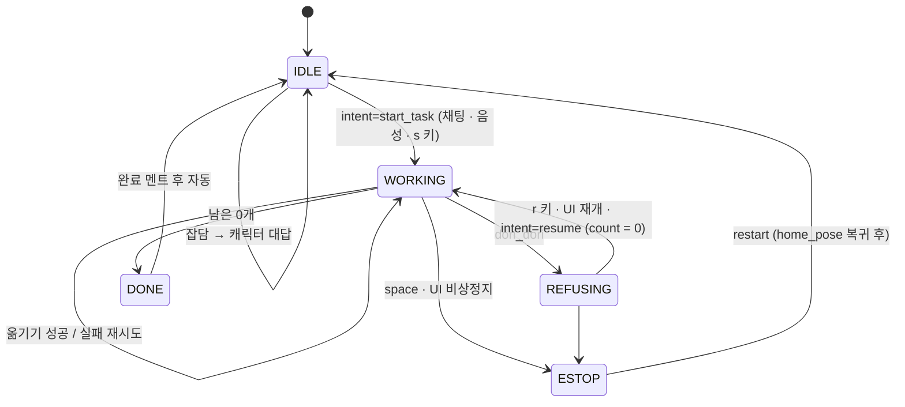
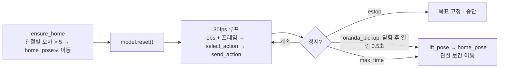

# 설계: 채팅 UI · provider 교체 · physicalai 로봇 연동

- 날짜: 2026-10-22
- 상태: 사용자 리뷰 대기
- 기존 문서(ARCHITECTURE / DECISION_LOGIC / DATASET_GUIDE / DEMO_RUNBOOK)와 충돌하면 **이 문서가 우선**한다.

## 1. 목표와 범위

섞인 과자 트레이에서 목표 과자(지금은 **오란다**)만 빈 트레이로 옮기는 로봇. 몇 번 일하면 지쳐서
도리도리로 거부하고, 달래면 다시 일한다. 이번 설계에서 추가하는 것:

1. **웹 UI**: 채팅으로 작업 지시·잡담·달래기, 상태·피로도·카메라 영상·성능 표시, 진행자 버튼
2. **STT**: UI의 🎤 누르고 말하기 → 채팅과 같은 경로
3. **provider 교체**: LLM / 개수 세기 / STT를 config로 바꿔 끼우기 (유료 API, OpenRouter, NVIDIA, 로컬 OpenVINO)
4. **로봇 연동을 physicalai 런타임으로**: ACT는 physical-ai-studio에서 학습해 OpenVINO로 내보낸 결과물을 로컬에서 실행

범위 밖: UI 디자인 자체(Claude Design 담당, `docs/UI_DESIGN_PROMPT.md`), 다중 로봇, 원격 접속.

## 2. 기존 문서 대비 바뀌는 점

| 항목 | 기존 | 변경 |
|---|---|---|
| 대상 과자 | 홈런볼 고정 | `config.target.name` (지금 "오란다"). 대사·프롬프트·UI가 이 값을 참조 |
| 옮기기 스킬 이름 | `move_homerunball` | `oranda_pickup` (Studio 데이터셋·정책 이름과 동일) |
| task 문장 | "Pick up the Home Run Ball snack ..." | `"PIck up the Snack and place it in the empty tray"` (녹화에 쓴 문장 그대로) |
| 상태 | WORKING 시작 | **IDLE** 추가. 채팅으로 작업 시작 |
| DONE | 종료 | 완료 멘트 후 **자동으로 IDLE** |
| ESTOP 후 | WORKING | **IDLE** (home_pose 복귀 후) |
| STT | 보류 | UI 🎤 push-to-talk → Whisper → 채팅 경로 |
| 로봇/ACT | LeRobot + PyTorch, 2단계 OpenVINO | **physicalai 런타임 + OpenVINO 결과물** (처음부터) |
| 진행 판정 (끝·성공) | VLM 개수 전후 비교 | **B → A 순서** (6.0절). B: 시작 개수 + 그리퍼 쥠 판정. A: counter 체인(YOLO → VLM → OpenCV)으로 개수 비교 |
| LLM | 로컬 OpenVINO | **provider 체인**: API(OpenRouter/NVIDIA/유료) → (선택) 로컬 → 규칙 |
| 진행자 키 | r / space / q | + `s` (작업 시작, `--no-ui`용) |
| 비상정지 | 미정 | **토크 유지**, 마지막 목표 자세 고정 |

## 3. 파일 구조

```
project/
├── CLAUDE.md
├── config.yaml              # 현장에서 고치는 값 (루트에 둠)
├── .env                     # API 키 (git 제외), .env.example만 커밋
├── snackbot/                # 파이썬 패키지 하나 (하위 폴더 없음)
│   ├── __init__.py
│   ├── __main__.py          # python -m snackbot --dry-run [--no-ui]. controller·server·콘솔 키 스레드 기동
│   ├── config.py            # config.yaml + .env 로드
│   ├── controller.py        # 상태 머신, 사이클 루프 스레드, 명령, 이벤트 발행
│   ├── server.py            # FastAPI: /ws, /stt, /stream/front, frontend/ 정적 서빙
│   ├── providers.py         # LLM/VLM/STT provider 어댑터 + fallback 체인
│   ├── brain.py             # decide() 작업 판단, chat() 의도·대사
│   ├── vision.py            # counter 체인: yolo / vlm / opencv / fake
│   ├── stt.py               # 음성 → 텍스트 (provider 사용)
│   ├── voice.py             # TTS (비동기)
│   └── skills.py            # physicalai: SO101·카메라·InferenceModel, 정지 조건, 자세 이동, 비상정지
├── frontend/                # Claude Design 결과물: index.html, app.js, style.css (빌드 없음)
├── tools/                   # python -m tools.<이름>. snackbot 모듈 재사용
│   ├── __init__.py
│   ├── save_pose.py         # 현재 관절값 → config home_pose / lift_pose
│   └── gripper_stats.py     # 데이터셋 마지막 프레임 그리퍼 값 통계 → 열림·쥠 기준값
├── tests/
│   ├── samples/             # dry-run 사진: tray_3.jpg, tray_2.jpg, tray_1.jpg, tray_0.jpg
│   ├── test_brain.py
│   └── test_controller.py
├── models/                  # 로컬 모델 (git 제외)
├── logs/                    # 사이클 JSONL (git 제외)
└── docs/
```

- 모든 명령은 project 루트에서 실행한다 (`python -m snackbot`, `python -m tools.save_pose home`, `pytest`).
- **의존 방향:** `server → controller → (brain, vision, skills, voice)`. controller는 FastAPI를 모른다. `--no-ui`면 server 없이 돈다.
- 프로세스 1개, 스레드 4종: controller 루프, uvicorn(메인), 콘솔 키, 카메라 캡처(skills 내부).

## 4. 상태와 채팅 흐름



| 상태 | 채팅 허용 intent | 처리 |
|---|---|---|
| IDLE / DONE | `start_task`, `chat` | start_task → 시작 개수 정하고 사이클 시작 (6.0절) |
| WORKING | `chat` | 대답만, 작업 영향 없음 |
| REFUSING | `resume`, `chat` (M5부터 resume) | resume → count = 0, WORKING |
| ESTOP | `chat` | 대답만. 해제는 restart 명령으로만 |

- `phase` (UI 표시용, WORKING 내부 단계): `idle | counting | thinking | acting | returning | waiting_operator`
- 옮기기 실패가 `max_retry`를 넘으면 WORKING 유지 + `phase=waiting_operator`. 재개 명령으로 다시 시도. count 불변.
- 동시성: controller의 상태 변경은 락 하나로 보호. brain의 LLM 호출(decide/chat)은 provider 내부 락으로 직렬화.

## 5. 모듈 인터페이스

| 모듈 | 공개 API | 비고 |
|---|---|---|
| controller | `Controller(cfg, skills, vision, brain, voice)`, `.start()`, `.chat(text, source="text")`, `.command(name)`, `.snapshot()`, `.subscribe(fn)` | `name`: `start, resume, estop, restart, quit`. 상태·count·대화 기록(최근 50개)은 여기만 보관 |
| brain | `decide(remaining, count, state, speech_text) -> {skill, say}` | 가드 규칙은 DECISION_LOGIC.md 그대로 (skill 이름만 `oranda_pickup`) |
| | `chat(text, state, count) -> {intent, say, n}` | 상태별 허용 intent 밖이면 키워드 규칙. `n`은 "3개 옮겨줘"의 개수 (없으면 null) |
| vision | `count(frame) -> Count(n, method, boxes) \| None` | A단계. 체인이 비었거나 전부 실패하면 None → B로 판정. `boxes`는 yolo일 때만 |
| stt | `transcribe(wav_bytes) -> str` | |
| voice | `speak(text)` | 비동기, 실패해도 예외 안 냄 |
| skills | `Skills(cfg, dry_run)`, `.run(name) -> {stop_reason, grasped, ms}`, `.ensure_home()`, `.move_to(pose)`, `.estop()`, `.release_estop()`, `.latest_frame(cam)`, `.close()` | `stop_reason`: `gripper_open, timeout, estop` |
| server | `create_app(controller, skills, stt) -> FastAPI` | |

controller 이벤트 → server가 `loop.call_soon_threadsafe`로 모든 WebSocket에 브로드캐스트.

## 6.0 진행 판정: B → A

과자를 찾아 집는 일은 ACT가 영상만 보고 한다. 별도 판정이 필요한 것은 ACT가 못 하는 두 가지다:
**언제 끝낼지**(남은 0개)와 **성공했는지**(count는 성공 때만 증가 → 거부 타이밍).

| | B (M1, 기본) | A (M3, 개선) |
|---|---|---|
| 시작 개수 | 채팅의 `n`("3개 옮겨줘") → 없으면 `target.initial_count` | 시작 전 counter로 셈 |
| 성공 판정 | `grasped`: oranda_pickup 중 그리퍼가 닫혔을 때의 값이 `grasp_min` 이상 (빈 그리퍼는 끝까지 닫힘) | 실행 전후 개수 감소. `grasped`는 로그용 보조 지표 |
| 남은 개수 | 시작 개수 − 성공 수 | counter 결과 |
| 한계 | 다른 과자를 집어도 성공으로 셈. 시작 개수가 틀리면 끝 판단도 틀림 | 모델·튜닝 필요 |

- `vision.chain`이 비어 있으면 B, 있으면 A. A에서 counter가 전부 실패한 사이클은 **그 사이클만 B로 판정**한다 (멈추지 않음).
- UI `state.vision_method`: B면 `estimate`, A면 실제 counter 이름.
- `grasp_min`: 빈 그리퍼를 끝까지 닫은 값과 데이터셋에서 과자를 쥐었을 때의 닫힘 값(`tools/gripper_stats.py`) 사이로 정한다.

## 6. provider 교체 (providers.py)

### 6.1 어댑터

| type | 대상 | 비고 |
|---|---|---|
| `openai_compat` | OpenRouter, NVIDIA(build.nvidia.com), OpenAI, Gemini(OpenAI 호환), Groq, 로컬 Ollama | `base_url` + `api_key_env`만 다름. 이미지 입력(VLM)·음성 전사도 이 형식 |
| `anthropic` | Claude | 공식 SDK |
| `openvino` | 로컬 `openvino_genai` LLMPipeline / VLMPipeline / WhisperPipeline | `model_dir`, `device` |

공통 함수: `complete(messages, image=None, max_tokens, timeout_s) -> str`, `transcribe(wav) -> str`.

### 6.2 체인과 타임아웃

- 역할마다 provider 목록을 두고 **순서대로 시도**. 예외·타임아웃이면 다음으로. 전부 실패하면 규칙 fallback.
- API 호출은 **타임아웃 필수**(기본 brain 5초). 로봇 루프가 네트워크 때문에 멈추면 안 된다.
- 어떤 provider가 응답했는지 사이클 로그와 UI `info`에 남긴다.

```yaml
providers:                       # 접속 정보. 키는 .env
  openrouter: {type: openai_compat, base_url: "https://openrouter.ai/api/v1", api_key_env: OPENROUTER_API_KEY}
  nvidia:     {type: openai_compat, base_url: "https://integrate.api.nvidia.com/v1", api_key_env: NVIDIA_API_KEY}
  openai:     {type: openai_compat, base_url: "https://api.openai.com/v1", api_key_env: OPENAI_API_KEY}
  anthropic:  {type: anthropic, api_key_env: ANTHROPIC_API_KEY}
  local_ov:   {type: openvino}

brain:
  chain:                         # 위에서부터 시도, 전부 실패 → 규칙
    - {provider: openrouter, model: "[모델 ID]", timeout_s: 5}
    - {provider: nvidia,     model: "[모델 ID]", timeout_s: 5}
```

시연 기본값: **판단·대사 LLM은 API**, ACT는 로컬 OpenVINO. 개수 세기·STT는 아래 체인에서 상황에 맞게.

### 6.3 개수 세기 counter 체인 (vision.py, A단계)

| type | 방식 | 근거 |
|---|---|---|
| `yolo` | Ultralytics OpenVINO 모델 폴더. YOLO-World에 텍스트 클래스를 지정해 내보낸 모델(제로샷) 또는 외부에서 받은 검출 모델 | `03_openvino_workspace/10_project_logistics_counter` 패턴 (`set_classes` → `save` → `export(format="openvino")`, `device="intel:gpu"`) |
| `vlm` | provider(로컬 openvino VLM 또는 API)에 이미지 + 질문, 숫자만 파싱, 1회 재시도 | 기존 설계 |
| `opencv` | 면적 + 색상(황갈색 HSV 범위) 판별. 오란다는 모양이 불규칙해 원형도는 보조 지표로만 | 기존 설계 수정 |
| `fake` | dry-run 사진 파일명(`tray_3.jpg`)에서 개수 | dry-run ① |

```yaml
vision:
  camera: front
  chain:                         # 비우면 B단계 (시작 개수 + 그리퍼 판정)
    - {type: yolo, model_dir: "models/oranda_world_openvino_model", classes: ["[오란다 묘사 텍스트]"], conf: 0.35, device: "intel:gpu"}
    - {type: vlm, provider: local_ov, model_dir: "models/vlm", device: GPU,
       prompt: "How many [오란다 생김새 묘사] are in the tray? Answer with a number only."}
    - {type: opencv, min_area: 800, max_area: 8000, hsv_low: [10, 60, 80], hsv_high: [30, 255, 255]}
```

클래스 텍스트·VLM 질문·HSV 값은 M3에서 실제 트레이 사진으로 정한다.

### 6.4 STT

```yaml
stt:
  chain:
    - {provider: local_ov, model_dir: "models/whisper", device: CPU, language: ko}
    - {provider: openai, model: "[전사 모델 ID]"}
```

## 7. 로봇 연동 (skills.py, physicalai 런타임)

### 7.1 사용 API (physicalai ~0.3, 설치 후 시그니처 확인 필요)

- `SO101(port, calibration, role="follower")`: `connect()`, `get_observation().joint_positions`, `send_action(arr, goal_time=...)`, `set_torque(enabled)`, `disconnect()`
  - 관절 순서: `shoulder_pan, shoulder_lift, elbow_flex, wrist_flex, wrist_roll, gripper`
  - 단위: 몸통 -100..100, 그리퍼 0..100 (정규화 단위). `home_pose`, `lift_pose`, 그리퍼 기준값 모두 이 단위
- `UVCCamera(device, width, height, fps)`: RGB HWC uint8
- `InferenceModel(export_dir, backend="openvino", device=...)`: `reset()`, `select_action(obs)` (chunk 큐 내장)
  - 입력: `state` (1, 6) float32, `images.<cam>` (학습 때 카메라 이름 그대로)
  - 정규화가 그래프에 포함 → 출력이 곧 관절 목표값
- 정책 결과물: Studio `exports/openvino/` = `act.xml`, `act.bin`, `manifest.json`
- Studio의 `RobotRuntime`/`Shared*`는 쓰지 않는다. 정지 조건·비상정지를 매 스텝 확인하려고 루프를 직접 돈다.

### 7.2 실행 흐름



- **그리퍼 정지 조건은 "닫힘 → 열림" 전이로 판단한다.** 홈 자세에서 그리퍼가 이미 열려 있으면 "열림만" 조건은 시작하자마자 걸린다. 닫힘 기준(`gripper_closed_below`)을 한 번 지난 뒤 열림 기준(`gripper_open_above`)을 0.5초 넘으면 정지. 기준값은 `tools/gripper_stats.py`로 데이터셋에서 정한다.
- **쥠 판정(`grasped`)**: 닫힘 구간에서 측정한 그리퍼 최솟값이 `grasp_min` 이상이면 과자를 쥔 것으로 본다 (6.0절 B).
- `dori_dori`: `max_time_s`만큼 실행 후 home_pose로 오차 보정.
- 자세 이동: 관절 공간 선형 보간, `steps`·`step_s`는 config. 매 스텝 estop 확인.
- 카메라: 캡처 스레드 하나가 카메라를 소유하고 최신 프레임을 캐시. ACT 루프·개수 세기·`/stream/front`가 모두 캐시를 읽는다.
- 시작 시 정책 2개 로드 + warmup.

### 7.3 비상정지 (토크 유지)

- `estop()`: 공유 이벤트 set → ACT 루프·보간 이동이 다음 스텝에서 중단.
- 정지 순간의 **목표값을 한 번 고정**해 두고 그 값만 유지한다 (측정값을 매번 다시 보내면 중력으로 처진다). 토크는 끄지 않는다.
- `restart` → `release_estop()` → home_pose로 천천히 이동 → IDLE.

### 7.4 config

```yaml
robot:
  port: "[/dev/ttyACM0]"
  calibration: "[calibration.json 경로, Studio runtime-config에서 받은 것]"
cameras:                          # 키 = 학습 때 카메라 이름 (두 정책 공통)
  front: {device: "[/dev/video0]", width: 640, height: 480, fps: 30}
  "[wrist 또는 gripper]": {device: "[/dev/video2]", width: 640, height: 480, fps: 30}
skills:
  fps: 30
  oranda_pickup: {export_dir: "[.../exports/openvino]", device: GPU, max_time_s: 20}
  dori_dori:     {export_dir: "[.../exports/openvino]", device: GPU, max_time_s: 6}
  gripper_closed_below: "[gripper_stats로 결정]"
  gripper_open_above:   "[gripper_stats로 결정]"
  grasp_min:            "[빈 그리퍼 닫힘 값과 쥠 값 사이]"
  open_hold_s: 0.5
  home_tolerance: 5
  move: {steps: 50, step_s: 0.04}
poses:                            # tools/save_pose.py가 기록
  home_pose: null
  lift_pose: null
target:
  name: 오란다
  initial_count: 3                # B단계: 채팅에 개수가 없을 때
```

## 8. UI 연동 계약

정확한 메시지 형식과 화면 요구사항은 `docs/UI_DESIGN_PROMPT.md`가 기준이다. 요약:

- `GET /` → `frontend/index.html`, `frontend/` 정적 파일
- `WS /ws`
  - 서버 → 화면: `info`(target, models), `state`(state, phase, count, remaining, skill, vision_method, thresholds), `message`(role, text, source, ts), `cycle`(n, result, ms)
  - 화면 → 서버: `chat`(text), `command`(resume | estop | restart)
  - 접속 직후: `info` 1개, `state` 1개, 최근 `message` 50개
  - 화면은 서버 메시지로만 그린다 (보낸 채팅도 서버 에코로 표시)
- `POST /stt`: 16kHz mono 16bit WAV → `{"text"}`. 서버가 `controller.chat(text, source="voice")`도 호출
- `GET /stream/front`: MJPEG. yolo 박스가 있으면 오버레이

## 9. 오류 처리

| 상황 | 처리 |
|---|---|
| counter 실패·파싱 실패 | 체인의 다음 counter. 전부 실패 → 그 사이클은 B 판정(시작 개수 − 성공 수, `grasped`) |
| LLM decide 실패 / 허용 외 값 | 다음 provider → 전부 실패 시 가드 규칙 + 준비된 대사 |
| LLM chat 실패 | 키워드 규칙: start(옮겨, 집어, 시작, 일해), resume(조금만, 부탁, 힘내, 한 번만) + 준비된 대사 |
| API 키 없음 | 해당 provider를 체인에서 건너뛰고 시작 시 경고 |
| 옮기기 재시도 초과 | `phase=waiting_operator`, 재개 명령 대기, count 불변 |
| 그리퍼 정지 미감지 | `max_time_s`에서 정지 → 복귀, `stop_reason=timeout` 기록. 성공 여부는 개수로 판정 |
| STT 실패 | UI에 system 메시지 "못 알아들었어요", 상태 영향 없음 |
| TTS 실패 | 무시 (대사는 UI에 이미 표시) |
| WebSocket 끊김 | controller 영향 없음. 재접속 시 상태·기록 재전송 |
| 로봇 포트 점유 | 시작 시 명확한 에러: "Studio 세션을 닫으세요" |

## 10. dry-run과 테스트

| 단계 | vision | brain | skills | 용도 |
|---|---|---|---|---|
| ① | 없음 (B) 또는 `fake` (A 흐름 확인) | 규칙만 (API 키 없어도 됨) | sleep | 상태 흐름, UI 개발 |
| ② | 샘플 사진에 실제 counter | 실제 provider | sleep | 프롬프트·클래스 텍스트 다듬기, 지연 측정 |
| ③ | 카메라 (또는 B) | 실제 | physicalai | 시연 |

- dry skills는 `dry_run.fail_rate` 확률로 `grasped=false`를 돌려준다 (실패 주입).
- `fake` counter를 쓰면 성공 시 샘플 사진이 tray_3 → tray_2 → tray_1 → tray_0으로 넘어간다.
- `tests/test_brain.py`: 가드 표, 출력 검증(깨진 JSON, 허용 외 skill, 가드 덮어쓰기, 80자 초과), chat 키워드 fallback, provider 체인(가짜 provider로 타임아웃·예외 시 다음으로 넘어가는지)
- `tests/test_controller.py`: B 판정(시작 개수·`n` 파싱·grasped로 성공/실패), A 판정(개수 감소), A 실패 사이클의 B 대체, 가짜 의존성으로 IDLE → WORKING → REFUSING → resume → DONE → IDLE, WORKING → ESTOP → restart → IDLE, 재시도 초과 → waiting_operator
- UI·하드웨어는 런북 체크리스트로 수동 확인

## 11. 완성 순서

| 단계 | 내용 | 완료 기준 |
|---|---|---|
| M0 | 환경 확인 (physicalai·openvino 버전, 디바이스, 카메라, 시그니처 확인), 모델·API 후보와 용량 제안 | 설치 목록 확정 |
| M1 | controller, brain 규칙, **B 판정**, dry skills, 콘솔 키, JSONL, 테스트 | `--dry-run --no-ui`로 전체 흐름 |
| M2 | server.py + 계약 구현 (Claude Design `frontend/` 병행) | 브라우저 채팅으로 dry-run 작업 시작 |
| M3 | providers + brain(decide·chat) + TTS, **counter 체인(A)** | dry-run ②: 실제 판단·대사, A 판정 |
| M4 | physicalai 연결: save_pose → 자세 이동 → dori_dori 단독 → oranda_pickup 단독(정지 조건·`grasp_min`) → 전체 루프 → 카메라 스트림 | 실제 시연 가능 (B만으로도) |
| M5 | 달래기: REFUSING에서 `resume` intent | 채팅으로 재개 |
| M6 | STT: `/stt` + stt.py | 말로 시작·달래기 |
| M7 | (선택) ACT 디바이스별 지연 비교 (`openvino-physical-ai-lab/scripts/bench_policy.py`) | 발표 비교표 |

시간이 부족하면 M7 → M6 → M5 → (M3의 counter 체인) 순으로 자른다. M4까지 B 판정 + 채팅 시작 + r 키만으로 시연이 성립한다.

## 11.5 확인된 사실 (2026-10-22, dori-dori 결과물과 06 실습)

`traind-model/dori-dori-model/` (physical-ai-studio 결과물, git 제외):

- 사용 파일: `exports/openvino/` = `act.xml`, `act.bin`, `manifest.json` (onnx·torch 내보내기와 `model.ckpt`도 있음)
- 입력: `state` (6), `images.tower cam`, `images.follow cam` (각 3×720×1280). **카메라 이름이 `tower cam` / `follow cam`** (띄어쓰기 포함). 7.4절의 `front` / wrist 가정을 이 이름으로 바꾼다.
- 전처리: letterbox 384×384 (manifest의 preprocessor). 출력: action (100, 6). `chunk_size = n_action_steps = 100`.

`06_physical_ai_agent_workspace/01_llm_robot_agent/robot_tools.py`의 실행 방식 (physicalai 0.3.0 시그니처 확인됨):

- 스킬마다 runtime.yaml: `RobotRuntime.from_config(path)` → `with runtime:` → `runtime.run(duration_s=...)` → `runtime.last_run_reason`. runtime.yaml 안의 모델 경로는 그 폴더 기준.
- **M4는 이 방식을 기반으로 한다.** 7.1~7.2의 "루프 직접 작성" 대신 `run(stop_event=...)`과 `callbacks`로 그리퍼 정지 조건·비상정지를 거는 방법을 먼저 확인한다.
- **카메라 점유:** 런타임이 실행 중에는 카메라를 잡고 있다. `/stream/front`와 개수 세기(A)는 런타임 밖에서 사진을 찍고 바로 놓는 방식(06의 `look_at_table`)으로 바꿀지 M4에서 정한다.
- 로컬 LLM 후보: Ollama `qwen3:4b-instruct` (06에서 도구 호출 비교 결과 가장 좋음) → config의 `ollama` provider로 연결 가능.

Studio(`192.168.0.6:7860`, 프로젝트 `dori-dori`)에서 읽은 설정 (조회 API만 사용):

- 카메라: `tower cam` (UVC index 0), `follow cam` (UVC index 2), 둘 다 1280×720@30.
- 로봇: `SO101 Follower` (runtime-config 기준 `/dev/ttyACM1`), `SO101 Leader` (`/dev/ttyACM0`). 학습 PC 기준 경로라 노트북에서는 바꿔야 한다 (`CHANGE_ME` 주석).
- 환경 runtime-config 구조: `physicalai.runtime.RobotRuntime` ← robot `physicalai.robot.SharedRobot` 안에 `physicalai_so101_plugin.SO101(port, calibration, role=follower, unit=normalized)`, cameras는 `physicalai.capture.SharedCamera` 안에 `UVCCamera(width, height, fps, device{index, serial…})` + `color_mode: RGB`, `fps: 30.0`, action_source는 환경 기본값이 `TeleopSource`(리더 팔). 정책 실행용 runtime.yaml은 action_source를 정책으로 바꾼 노트북 전용 파일을 따로 만든다 (openvino-physical-ai-lab 06 교안 5절).
- dori_dori 모델: dataset `dori_dori`(v1, v2), `dori_dori_4`(최신, onnx·openvino·torch 내보내기), task 문장 `"Shake the arm side to side to say no"`.
- 2026-10-22 오후 기준 이 Studio에는 oranda_pickup 데이터셋·모델이 아직 없다 (학습 중 작업 1개 진행 중).

## 12. 미확인 사항 (M0에서 확인)

- physicalai 런타임 설치 경로: PyPI `physicalai[so101-plugin]` (실습 자료) vs Studio가 고정한 git 커밋. 실제 시그니처(`SO101`, `InferenceModel.select_action` 입력 형식, uint8 HWC 허용 여부)
- 학습에 쓴 카메라 이름 (손목 카메라가 `wrist`인지 `gripper`인지), dori_dori 정책도 같은 카메라 이름인지
- 로봇 노트북(Ubuntu 24.04)의 OpenVINO GPU/NPU 디바이스 문자열
- 사용할 API 모델 ID와 키 준비 여부
